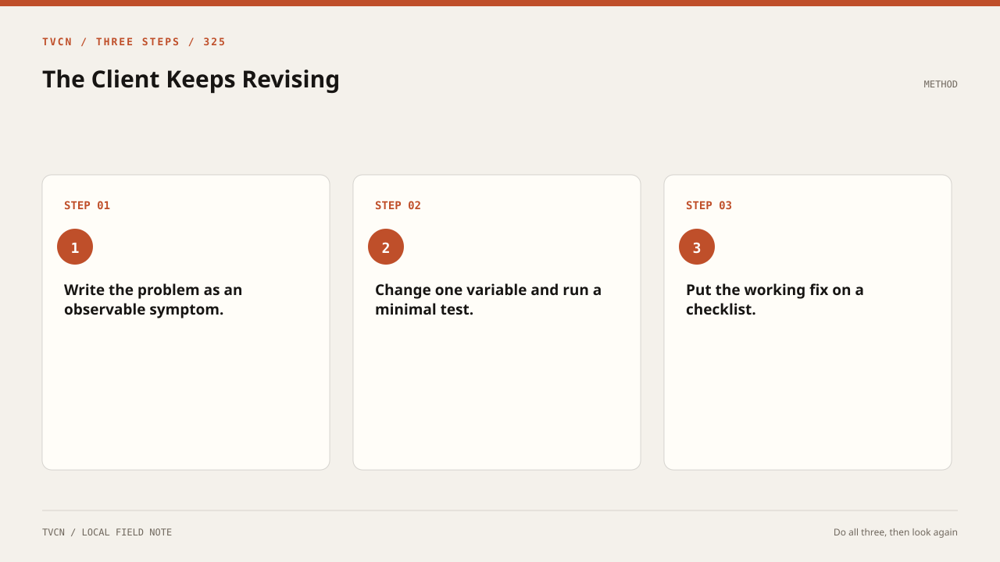

Write the objective in one sentence and test every revision against it.

<!-- DIAGRAM_START -->
<h2>Diagram</h2>
<figure>
  
  <figcaption>Do the three steps in order, then look again at the image or file.</figcaption>
</figure>
<!-- DIAGRAM_END -->
<h2>On set</h2>

Write the goal in one sentence and check every revision against it. Quote separately for scope creep.

<h2>Do this</h2>

Endless client revisions: write the goal in one sentence, then judge every change against it.
<ol><li>Put one line in the brief: “this film makes whom do what,” and get both sides to confirm.</li><li>Collect notes in rounds, one category per round; quote extra rounds beyond the contract.</li><li>After each change, ask whether it makes the goal clearer or fuzzier.</li></ol>
<h2>Avoid</h2>

Do not accept every note under “the client is always right”; unlimited revisions sink the project.

<h2>Check</h2>
<ul><li>The brief contains one line: “makes whom do what,” confirmed by both sides.</li><li>Notes arrive in rounds, one category per round.</li><li>Extra rounds are quoted; revisions are not unlimited.</li></ul>

<!-- DEEP_DIVE_START -->
## Deep dive

<strong>About 6 minutes.</strong> Endless revisions are usually an unlocked brief, not a bad client. Turn spoken opinions into one page.

### Lock the brief

Write five things: who watches, what they do after, what must appear, what must never appear, three reference films. Get confirmation on that page, not a “sure” in a chat thread.

Mark each reference “structure” or “style.” Without that, the client wants every strength of all three, and nobody can deliver it.

### Three kinds of changes

Bug fixes are free: a typo, a black frame, out-of-sync audio. Scope changes are billed: a new scene, a new version, a different actor. Taste changes use the included round: color, music, pacing. Track the three separately so the client sees what they are asking for.

Give every revision a version number and a cutoff. Past the cutoff, it moves to the next round. Do not edit while chatting; otherwise nobody knows which version is current.

### Protect the edit

Do not let clients into the timeline. Have them comment on a timecoded review link. Each note says minute, second, what to change, and why. “It feels off” is not a note.

If notes contradict each other, go back to the brief: which goal changed? If the goal is the same, keep the original plan. If the goal changed, it is a new project; quote again.

### Five-minute drill: translate three notes

Take three client lines and translate each into one executable action: add a close-up, change the music to no drums, move the ending five seconds earlier. If you cannot translate it, book ten minutes on the phone; do not guess.

Put the three translations on the change sheet and ask the client to confirm “this is what I mean.” One confirmation can save three rounds.

### When a revision is finished

A revision is done when the client confirms the latest version is deliverable, every note on the change sheet has an answer, and the version number stops moving. Do not end a round with “should be fine.”

Archive the final version with the change sheet. When someone later asks why this changed, the sheet answers. Unrecorded changes become new arguments.

### Ten client-revision checks
<ul><li>Brief has five items</li><li>Client confirms on paper</li><li>References marked structure or style</li><li>Bug fixes free</li><li>Scope changes quoted</li><li>Taste changes use the round</li><li>Every revision numbered</li><li>Clear cutoff time</li><li>Timecoded review link</li><li>Contradictions return to the brief</li></ul>
Revisions are not a fight. They are proof that two people still lack the same one-page answer to “what is this film.”

<!-- DEEP_DIVE_END -->
