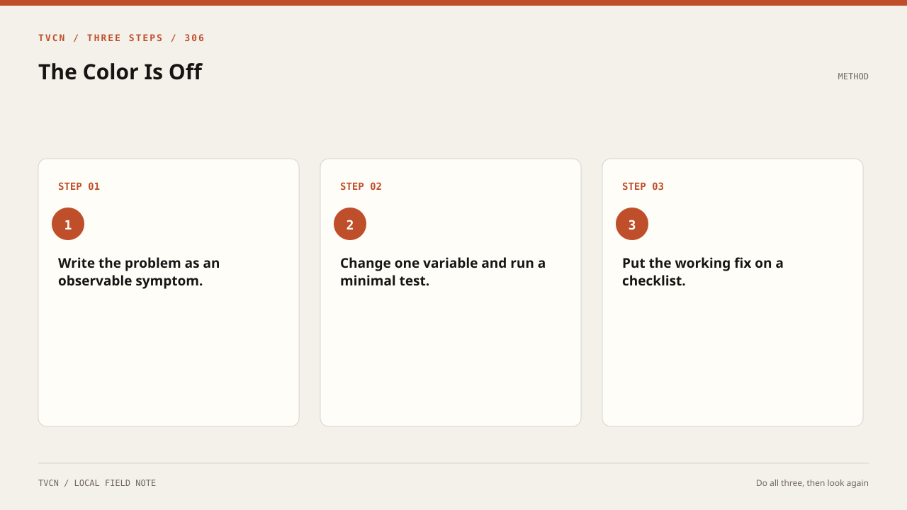

Fix white balance and mixed light before color wheels; grading a bad source gets dirtier.

<!-- DIAGRAM_START -->
<h2>Diagram</h2>
<figure>
  
  <figcaption>Do the three steps in order, then look again at the image or file.</figcaption>
</figure>
<!-- DIAGRAM_END -->
<h2>On set</h2>

Check white balance and mixed light first. Neutralize with a grey card, then grade.

<h2>Do this</h2>

A color cast starts with white balance and mixed light, not the color wheels. Fix the source or every correction gets dirtier.
<ol><li>Shoot a gray card or white paper under each light position to confirm white balance.</li><li>Turn off or unify mixed sources; gel windows with CTO or CTB so warm and cool stop fighting.</li><li>Balance to the gray card first, then grade; correct the cast, do not invent a style.</li></ol>
<h2>Avoid</h2>

Do not grade over mixed light; the face will go green in one patch and yellow in another.

<h2>Check</h2>
<ul><li>A gray card or white paper was shot under every light position.</li><li>Mixed sources are unified or turned off; warm and cool no longer fight.</li><li>Post balances to the card and skin is not green in one patch and yellow in another.</li></ul>
