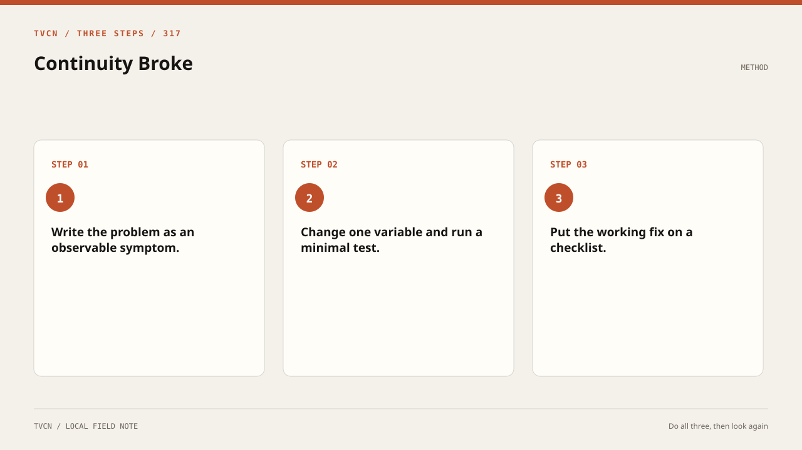

Before each camera move, have the script supervisor take three frames: wide, prop detail, hands. Compare them with the last frame of the previous setup before deciding whether to reshoot.

<!-- DIAGRAM_START -->
<h2>Diagram</h2>
<figure>
  
  <figcaption>Watch “Every time you change the camera or wardrobe,” and “Assign one person to track props, collar, watch,”; judge whether the symptom can be restated as one observable sentence.</figcaption>
</figure>
<!-- DIAGRAM_END -->
<section><h2 id="section-1">Check four continuity classes</h2>
<ul><li><strong>Props:</strong> cup position, cigarette length, phone screen. Photograph the prop before and after every shot.</li><li><strong>Wardrobe:</strong> collar, cuffs, sweat, buttons. Keep the actor in the same garment; do not fix it in post.</li><li><strong>Blocking:</strong> a character exits left and enters right in the next shot. Mark positions and use landmarks.</li><li><strong>Light:</strong> the window turns from day to night, shadows change direction. Shoot coverage before close-ups.</li></ul>
<h2 id="section-3">When not to reshoot</h2>

If the break sits at the edge of frame and carries no story information, use an insert or sound to move attention; do not reshoot a whole scene for a cup. A break on the hero's face must be reshot.
</section><section><h2 id="section-4">On set</h2>
Photograph the table, hands, and wardrobe before rolling. Compare before wrap.
</section><section><h2 id="section-5">Do this</h2>
A continuity break: take a set photo, then check props, wardrobe, hands, and table. Continuity lives in records, not memory.
<ol><li>Every time you change the camera or wardrobe, shoot a wide and a detail photo.</li><li>Assign one person to track props, collar, watch, and how much drink is left.</li><li>Check photos by scene before the edit; fix breaks with pickups or inserts.</li></ol></section><section><h2 id="section-6">Avoid</h2>
Do not match from memory; memory keeps the big shape, not the details.
</section><section><h2>Boundary</h2>
This page only covers “Continuity Broke”; it does not replace The Crew Is Fighting, The Shadows Are Dirty, 16mm: Cinema Left the Theater. When the problem belongs to one of those pages, use that page instead of adding more parameters here.
</section><section><h2>Alternative</h2>
If “Props: cup position, cigarette length, phone screen. Photograph the prop before and after every shot” is not the main problem, start with “Wardrobe: collar, cuffs, sweat, buttons. Keep the actor in the same garment; do not fix it in post”; only upgrade after both hold.
</section><section><h2>60-second test</h2>
Run one 60-second test against check 1: Every camera or wardrobe change has a wide and detail photo. If check 2 (One person tracks props, collar, watch, and drink level) does not change, do not add gear or budget.
</section>
<h2>Check</h2><ul><li>Every camera or wardrobe change has a wide and detail photo.</li><li>One person tracks props, collar, watch, and drink level.</li><li>Photos are checked by scene before the edit; breaks are fixed with pickups or inserts.</li></ul>

<!-- SOURCES_START -->
## Experience note

Experience note:This page draws on 5 projects with one lead and a two-to-three-person crew, a fixed budget and schedule; it covers the decision order for “Continuity Broke”, not an external laboratory test, multi-camera, union crews, stunts or high-risk sets.
<!-- SOURCES_END -->

