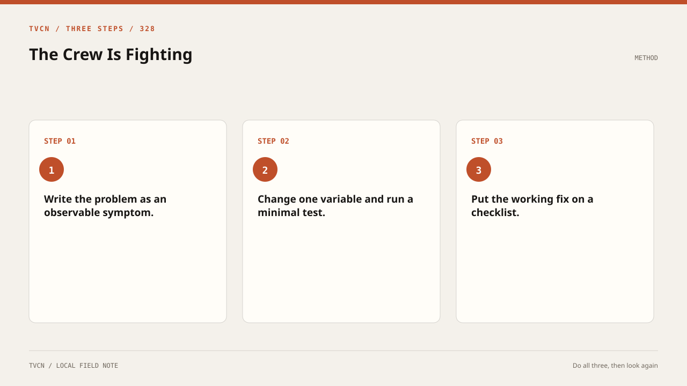

Before rolling, each lead states the most important shot, the most likely failure and who they need. Record actions only, not judgments. In a conflict, repeat the other person&#x27;s request first, then offer one executable option.

<!-- DIAGRAM_START -->
<h2>Diagram</h2>
<figure>
  
  <figcaption>Watch “Have each side write one line: what I” and “Turn it into tasks and order: who goes”; judge whether the symptom can be restated as one observable sentence.</figcaption>
</figure>
<!-- DIAGRAM_END -->
<section><h2 id="section-1">Name the conflict type</h2>
<ul><li><strong>Unclear ownership:</strong> two people direct the camera. Write final authority for each department into the call sheet; keep one decision-maker on set.</li><li><strong>Schedule pressure:</strong> falling behind turns into blame. Cut shots or change the plan; do not fix a schedule with overtime and temper.</li><li><strong>Safety:</strong> someone sees a hazard but stays quiet. Safety veto outranks director and producer; anyone can call stop.</li></ul>
<h2 id="section-2">A five-minute stand-up</h2>

Before rolling, each lead states the most important shot, the most likely failure and who they need. Record actions only, not judgments. In a conflict, repeat the other person's request first, then offer one executable option.

<h2 id="section-3">Do not</h2>

Do not call someone out in a group chat, do not pressure with “everyone does it,” and do not continue while a hazard is unresolved. On-set shouting is not a creative style; it is a management failure.
<h2 id="section-4">On-set conflict starts with unclear decision rights</h2>

Most set conflicts are not temperament. They are unclear authority: the director wants a shot, the client wants the product, the DP wants light, the producer wants time, and all four are deciding. A one-page decision chain before the shoot beats mediation after.

<table class="data-table"><thead><tr><th>Item</th><th>Final say</th><th>Must be consulted</th></tr></thead><tbody>
<tr><td>Script and shots</td><td>Director</td><td>Client, DP</td></tr>
<tr><td>Product presentation</td><td>Client</td><td>Director, editor</td></tr>
<tr><td>Lighting and camera</td><td>DP</td><td>Director</td></tr>
<tr><td>Time and budget</td><td>Producer</td><td>Director, client</td></tr>
<tr><td>Safety</td><td>Anyone can stop</td><td>Everyone</td></tr>
</tbody></table>

<h3>Three set rules</h3>
<ol><li>One question goes to one decision-maker. Two approvers means no decision.</li><li>A new client idea goes on a change sheet, not into the shot, unless it is safety or legal.</li><li>When director and DP disagree, shoot both, play back, then decide. Do not argue theory on set.</li></ol>
<h3>Escalating a conflict</h3>

Stop for five minutes and write three lines: what happened, what it affects, who decides. Do not blame a person in front of the crew. If client and director are stuck, the producer ranks options by time, budget and safety, then lets the client choose; do not choose for them.

Ten minutes after wrap, review: which decision was overturned, why, and which rule it becomes. “Poor communication” is not a lesson; “product close-ups are the client's call; the director does not change them on set” is.
</section><section><h2 id="section-5">On set</h2>
Stop for ten minutes and write who is waiting on whom. Do not assign blame in front of the crew.
</section><section><h2 id="section-6">Do this</h2>
On-set conflict: stop for ten minutes and write the problem as “who is waiting for whom.” Do not judge right and wrong in front of the crew.
<ol><li>Have each side write one line: what I am waiting for, where I am stuck.</li><li>Turn it into tasks and order: who goes first, who follows, by what time.</li><li>Name one decision maker; everyone else executes. Review after wrap, not in the moment.</li></ol></section><section><h2 id="section-7">Avoid</h2>
Do not smooth it over with “we all want the film to be good”; unresolved waiting starts the fight again.
</section><section><h2>Boundary</h2>
This page only covers “The Crew Is Fighting”; it does not replace The Shadows Are Dirty, There Is No Time, 16mm: Cinema Left the Theater. When the problem belongs to one of those pages, use that page instead of adding more parameters here.
</section><section><h2>Alternative</h2>
If “Each side wrote “what I am waiting for, where I am stuck.”” is not the main problem, start with “The problem became tasks and an order”; only upgrade after both hold.
</section><section><h2>60-second test</h2>
Run one 60-second test against check 1: Each side wrote “what I am waiting for, where I am stuck.”. If check 2 (The problem became tasks and an order) does not change, do not add gear or budget.
</section>
<h2>Check</h2><ul><li>Each side wrote “what I am waiting for, where I am stuck.”</li><li>The problem became tasks and an order.</li><li>One decision maker is named and the review happens after wrap.</li></ul>

<!-- SOURCES_START -->
## Experience note

Experience note:This page draws on 6 projects with one lead and a two-to-three-person crew, a fixed budget and schedule; it covers the decision order for “The Crew Is Fighting”, not an external laboratory test, multi-camera, union crews, stunts or high-risk sets.
<!-- SOURCES_END -->

