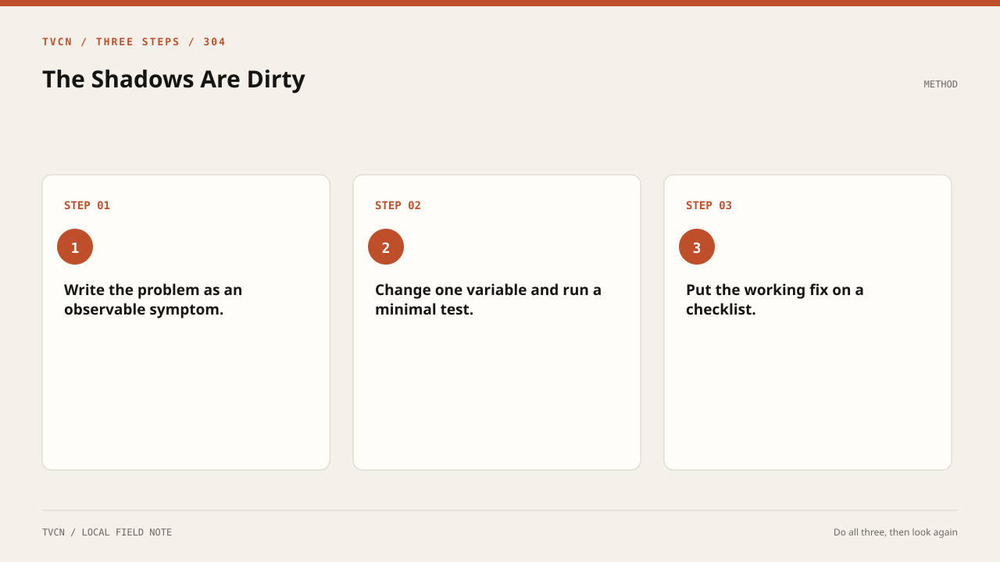

Lower ISO, add ambient light, and do not lift shadows hard; lifted black is noise.

<!-- DIAGRAM_START -->
<h2>Diagram</h2>
<figure>
  
  <figcaption>Do the three steps in order, then look again at the image or file.</figcaption>
</figure>
<!-- DIAGRAM_END -->
<h2>On set</h2>

Drop to native ISO, add a small ambient light, and do not lift the shadows hard. Let some black stay.

<h2>Do this</h2>

Noisy shadows: lower ISO, add a little ambient light, and do not force the shadows up. Lifted blacks are noise.
<ol><li>Set ISO to its native base; accept a slightly darker image.</li><li>Add a quarter stop to the shadow with a small lamp or reflector; do not light the face straight on.</li><li>Lift shadows only slightly in post and keep blacks black; do not excavate the noise.</li></ol>
<h2>Avoid</h2>

Do not use “cinematic” as an excuse for underexposure; crushed shadows do not come back.

<h2>Check</h2>
<ul><li>ISO is at its native base and shadows show no chroma noise.</li><li>The shadow got a little fill but blacks remain black.</li><li>Post lifts shadows only slightly and does not excavate noise.</li></ul>
