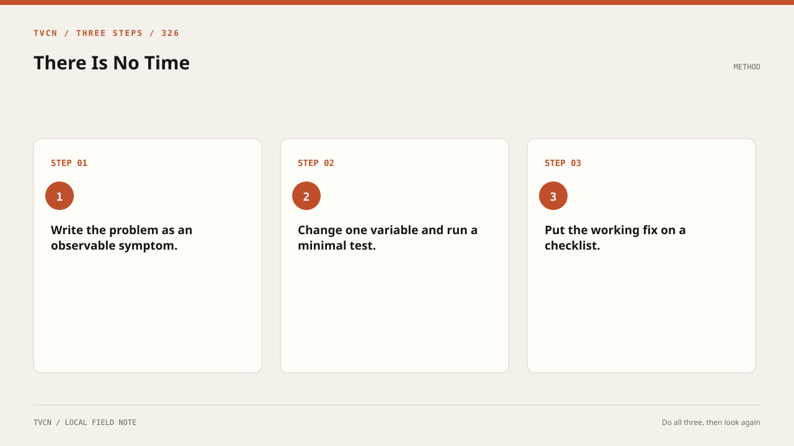

Fix the delivery date and immovable gates: client review, platform launch, event date. Then count back through post, shoot, prep and recce, leaving rework time—not “probably enough.”

<!-- DIAGRAM_START -->
<h2>Diagram</h2>
<figure>
  
  <figcaption>Watch “Split the shot list into must-have and nice-to-have;” and “Merge locations and camera setups to cut moves.”; judge whether the symptom can be restated as one observable sentence.</figcaption>
</figure>
<!-- DIAGRAM_END -->
<section><h2 id="section-1">Schedule backward from delivery, not forward from the shoot</h2>
Write latest decision dates: if the location is not locked by then, switch; if cast is not confirmed, rewrite.
<h2 id="section-2">Limits</h2>
Rushing does not mean cutting sound and QC. When time is short, cut scope, not acceptance; a film without sound and QC is not delivered.
<h2 id="section-3">Back-planning is not squeezing the schedule; it is finding the critical path</h2>

“Next week” is usually not a date; it is anxiety. Ask for three dates: internal review, platform launch and the latest acceptable delivery. Once those exist, plan backwards; do not count days from today.

<table class="data-table"><thead><tr><th>Back-planned milestone</th><th>Minimum reserve</th><th>Cost of compressing it</th></tr></thead><tbody>
<tr><td>Final delivery</td><td>2 days before launch</td><td>No revision or transcode buffer</td></tr>
<tr><td>Client final review</td><td>1 day before delivery</td><td>Notes cannot be fixed; errors ship</td></tr>
<tr><td>Rough cut</td><td>2 days before final review</td><td>Structural problems surface at the end</td></tr>
<tr><td>Shoot</td><td>1 day before rough cut</td><td>No backup; edit starts with damaged media</td></tr>
<tr><td>Script / storyboard lock</td><td>2 days before shoot</td><td>On-set rewrites; crew and location idle</td></tr>
</tbody></table>

<h3>There is only one critical path</h3>

Write the prerequisites for every task; the longest chain is the critical path. Compressing a non-critical task does not finish the project earlier; it only creates a longer wait. If the shoot on the critical path is one day, do not spend the budget on a second camera; protect that day first.

<h3>Name three buffers</h3>
<ul><li>Shoot buffer: weather, location, late talent, two hours.</li><li>Post buffer: software crash, media re-transcode, one day.</li><li>Client buffer: approval delay, one day.</li></ul>

A buffer is not “if there is time.” Put it on the calendar and tell the client, “these days are protected; no new tasks.” An unnamed buffer will always be eaten by another meeting.
</section><section><h2 id="section-4">On set</h2>
Cut shots and scenes, not sound and backup. Post can be lean; media cannot be missing.
</section><section><h2 id="section-5">Do this</h2>
Short on time: cut shots and locations, not sound or backup. Post can be leaner; footage cannot be missing.
<ol><li>Split the shot list into must-have and nice-to-have; shoot must-have first.</li><li>Merge locations and camera setups to cut moves.</li><li>Protect fixed time for backup, meals, and wrap; do not squeeze them.</li></ol></section><section><h2 id="section-6">Avoid</h2>
Do not trade sleep or backup for time; a failure costs more.
</section><section>
<strong>Boundary</strong>

It does not guarantee a story. The template only orders structure; the person, obstacle and cost still need writing.
</section><section><h2>Alternative</h2>
If “Split the shot list into must-have and nice-to-have;” is not the main problem, start with the basic move behind “Merge locations and camera setups to cut moves.”. Upgrade only after both hold.
</section><section><h2>60-second test</h2>
Run a 60-second test with the gear you own, focused on “Split the shot list into must-have and nice-to-have;”, and record one number. If the number does not change, do not add budget.
</section><section><h2>When not to use</h2>
Do not use the template when “Split the shot list into must-have and nice-to-have;” is still unclear or “Merge locations and camera setups to cut moves.” is only filler. Go back to the person and the problem.
</section><section><h2>Three failures</h2><ul><li>Every beat exists, but no one makes a decision.</li><li>The middle changes location, not information.</li><li>The ending is narrated, with no visible change.</li></ul></section>
<h2>Check</h2><ul><li>The shot list is split into must-have and nice-to-have; must-have is shot first.</li><li>Locations and setups are merged and moves reduced.</li><li>Time for backup, meals, and wrap is protected.</li></ul>

<!-- DEEP_DIVE_START -->
## Deep dive

<strong>About 6 minutes.</strong> Not enough time is not a reason to work late. It is a reason to schedule backward and cut scope first.

### Schedule backward from delivery

Write the delivery date first, then work backward: final export, client review, mix, fine cut, assembly, shoot, prep. Give every stage a twenty percent buffer; do not save the buffer for the end.

The shoot day is not “finished shooting”; it is “material can enter the edit.” If you cannot back up and transcode that day, everything downstream slips.

### Cut scope first

When time halves, cut locations, cameras, and versions, not sleep. One location, one camera, one version can still hold quality; three locations, two cuts, four aspect ratios will all be mediocre.

Split “must have” and “nice to have” into two columns. If there is only time for the first, delete the second. Do not add while working.

### A visible deliverable every day

Break the project into daily deliverables: selects today, assembly tomorrow, sound the day after. End every day with a file someone can open. “Working on it” is not progress.

If a day slips, the next day restores the deliverable before optimizing images. Polish can move later; structure cannot.

### Five-minute drill: backward schedule

Take a real delivery date and write seven rows backward: export, review, mix, fine cut, assembly, shoot, prep. Give each row a date and a name. No name means it is not scheduled.

Write the buffer as its own row before the shoot, not at the end. Circle every row without an owner in red and resolve it today.

### When the deadline is met

Met does not mean exported. It means the client can open it, play it, download it, and publish it. Export is half. Upload, review, subtitles, and cover all passing is the other half.

The day before delivery, do a full pass: open it on another device, watch muted, listen with headphones, click every link. When the pass clears, the deadline is actually safe.

### Ten deadline checks
<ul><li>Schedule backward from delivery</li><li>Seven stages with dates</li><li>Twenty percent buffer each</li><li>Buffer before the shoot</li><li>Shoot day means material can enter edit</li><li>Cut locations, cameras, versions first</li><li>Must-have and nice-to-have separated</li><li>Visible deliverable every day</li><li>Restore structure before polish</li><li>Every row has an owner</li></ul>
A deadline is not for staying up late. It is for deciding what does not get made this time.

<!-- DEEP_DIVE_END -->
