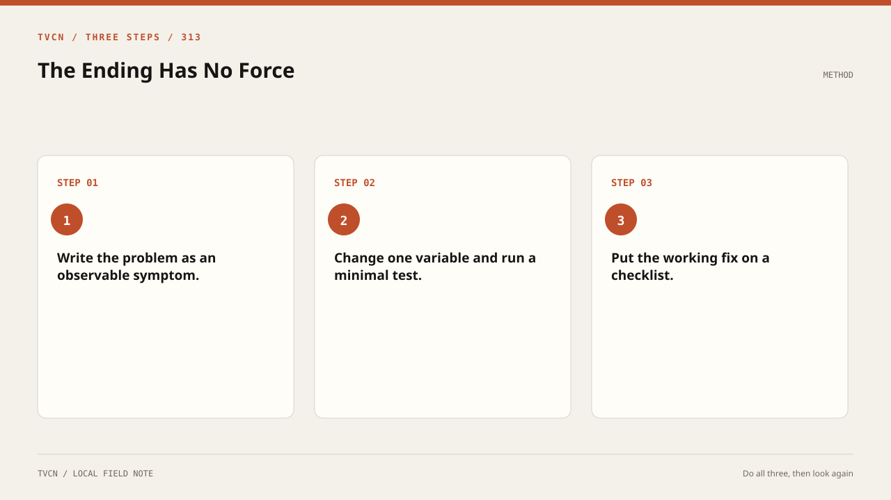

A weak ending usually means the character paid no price. Make them choose, then stop.

<!-- DIAGRAM_START -->
<h2>Diagram</h2>
<figure>
  
  <figcaption>Watch “Turn the ending into a choice where both” and “Let them make the choice; do not let”; judge whether the symptom can be restated as one observable sentence.</figcaption>
</figure>
<!-- DIAGRAM_END -->
<section><h2 id="section-1">On set</h2>
Make the character pay a price, choose, and stop on the action after the choice.
</section><section><h2 id="section-2">Do this</h2><ol><li>Turn the ending into a choice where both options cost something.</li><li>Let them make the choice; do not let someone else solve it.</li><li>End on a concrete action: close the door, put down the key, walk away. Do not explain.</li></ol></section><section><h2 id="section-3">Avoid</h2>
Do not push emotion with crying or music; the cost must be visible.
</section><section><h2 id="section-4">Three causes</h2>
For “The Ending Has No Force”, check three directions first. Change one variable, record a 30-second comparison, and see which link the change follows.

<table class="data-table"><thead><tr><th>Cause</th><th>Signal on set</th><th>Five-minute test</th></tr></thead><tbody><tr><td>Too much explanation</td><td>Voice-over summarises the theme and leaves nothing for the audience</td><td>Remove the summary and end on action</td></tr><tr><td>Ending on the answer</td><td>The character already has the result and the film explains it</td><td>End at the moment of choice</td></tr><tr><td>No cost</td><td>Nothing is lost, so the emotion has nowhere to land</td><td>Make the choice carry a visible cost</td></tr></tbody></table>
</section><section><h2 id="section-5">On-set diagnosis</h2><ol><li>Find the last choice in the film: what the character decides to do or not do.</li><li>See whether the last shot sits before, during or after the choice; if it sits too long after, shorten it.</li><li>Watch the last ten seconds with sound off; does the picture still work?</li></ol></section><section><h2 id="section-6">Fix</h2>
An ending does not exhaust the story; it leaves the character inside a choice. The audience should leave with a question, not a summary.
<ol><li>Hold one or two seconds after the choice; do not add an explanation shot.</li><li>Put the theme in an action: close a door, set down keys, turn away.</li><li>Remove voice-over summaries and title cards; put any necessary note outside the film.</li><li>Leave the last shot unfinished: a hand in mid-air, a door not fully closed.</li></ol></section><section><h2 id="section-7">Failure cases</h2>
With “The Ending Has No Force”, these three moves make it worse. Pick one replacement action and do not change three variables at once.

<table class="data-table"><thead><tr><th>Failure</th><th>Why it gets worse</th><th>Replace with</th></tr></thead><tbody><tr><td>Add a montage summary</td><td>The emotion repeats and the audience waits for credits</td><td>Keep one action</td></tr><tr><td>Add voice-over</td><td>The theme is stated and the image loses weight</td><td>Let the image end itself</td></tr><tr><td>End on the answer</td><td>Once the character has the result, the scene is over</td><td>End on the choice, not the result</td></tr></tbody></table>
</section><section><h2 id="section-8">Acceptance table</h2>
Acceptance is not “it feels better”; all four must be identifiable, playable and logged.

<table class="data-table"><thead><tr><th>Check</th><th>Pass line</th><th>Log</th></tr></thead><tbody><tr><td>Last choice</td><td>The ending contains an identifiable choice</td><td>Mark the timecode</td></tr><tr><td>Duration</td><td>No more than two seconds after the choice</td><td>Watch the last ten seconds</td></tr><tr><td>Explanation</td><td>No voice-over or card summarises the theme</td><td>Inspect the tail</td></tr><tr><td>Aftertaste</td><td>The last shot holds an unfinished action</td><td>Play it back</td></tr></tbody></table>
</section><section><h2>Boundary</h2>
This page only covers “The Ending Has No Force”; it does not replace How to Get the First Client, You Only Have a Vague Idea, 16mm: Cinema Left the Theater. When the problem belongs to one of those pages, use that page instead of adding more parameters here.
</section><section><h2>Alternative</h2>
If “Turn the ending into a choice where both options cost something” is not the main problem, start with “Let them make the choice; do not let someone else solve it”; only upgrade after both hold.
</section><section><h2>60-second test</h2>
Run one 60-second test against check 1: The ending is a choice where both options cost something. If check 2 (The character makes the choice; nobody solves it for them) does not change, do not add gear or budget.
</section>
<h2>Check</h2><ul><li>The ending is a choice where both options cost something.</li><li>The character makes the choice; nobody solves it for them.</li><li>It ends on a concrete action, with no explanatory voice-over.</li></ul>

<!-- SOURCES_START -->
## Experience note

Experience note:This page draws on 6 projects with one lead and a two-to-three-person crew, a fixed budget and schedule; it covers the decision order for “The Ending Has No Force”, not an external laboratory test, multi-camera, union crews, stunts or high-risk sets.
<!-- SOURCES_END -->

