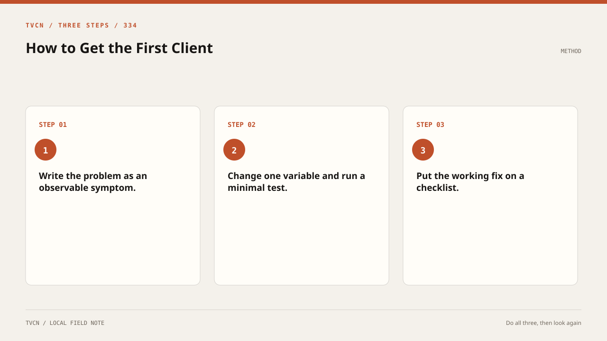

Start with acquaintances, community, and small shops; send a specific proposal, not a portfolio blast.

<!-- DIAGRAM_START -->
<h2>Diagram</h2>
<figure>
  
  <figcaption>Do the three steps in order, then look again at the image or file.</figcaption>
</figure>
<!-- DIAGRAM_END -->
<h2>On set</h2>

Start with friends, community, and small shops. Send one concrete proposal, not a poster.

<h2>Do this</h2>

Your first client comes from people you know, your community, and small businesses. Send a specific plan, not a portfolio poster.
<ol><li>List ten people or shops you might know; pick one with a real need.</li><li>Give them a one-page plan: what, how long, what they get, what it costs.</li><li>Do one small job, deliver on time, then ask for a quote or referral.</li></ol>
<h2>Avoid</h2>

Do not mass-message “I make videos”; a specific plan beats a self-introduction.

<h2>Check</h2>
<ul><li>Ten people or shops were listed and one with a real need was chosen.</li><li>A one-page plan states what, how long, what they get, and the price.</li><li>The small job was delivered on time and earned a quote or referral.</li></ul>

<!-- DEEP_DIVE_START -->
## Deep dive

<strong>About 7 minutes.</strong> Your first client does not wait for a perfect portfolio. You write scope, price, and delivery clearly and trade a small project for trust.

### Sell one small, clear job

Do not pitch a brand film for your first job. Pitch one thirty- or sixty-second product video: one location, one person, one deliverable. The smaller the scope, the more likely you deliver on time and the client tries you.

Ask three questions: who watches it, what should they do after, when is it needed? If the answers are unclear, do not quote yet; every later revision will come from those three blanks.

### Quote in four lines

Scope, deliverables, revision rounds, rights and payment milestones. Four lines on one page. Deposit at least half; balance before the source files leave. Never write “pay what you think.”

Price by time and usage, not by runtime. Thirty seconds is not necessarily cheaper than three minutes; shoot days, cameras, talent, and post decide the cost.

### Delivery and the relationship

Include one revision round in the quote; extra rounds are billed hourly or per version. Collect feedback once, in one link, not as a stream of voice messages.

Deliver three files: a platform-compressed version, a high-quality master, and a cover image, plus one page of notes. A case study one week after delivery is worth more than dinner with the client.

### Five-minute drill: one-page quote

Take a real small request and write one page: scope, deliverables, revisions, rights, payment, schedule. No company introduction, no “we are professional.”

Send the page to a peer and ask which line a client could misread. Fix that line, then send it. The first job is not to earn the most; it is to deliver one complete project without rework.

### When the first job is delivered

The job is delivered when the client has three files, has confirmed they play, the balance has arrived, and the usage range is written down. Sending files is not delivery. Leave a twenty-four-hour confirmation window so a broken file is found now, not next week.

The delivery email states which version is final, which files are for platforms, which are for archive, and how the next revision is billed. Four lines save ten explanation emails later.

### Ten first-client checks
<ul><li>First job is small</li><li>One location, one person, one deliverable</li><li>Audience and action asked first</li><li>Delivery date written</li><li>Four-line quote on one page</li><li>Deposit at least half</li><li>Balance before source files</li><li>One revision round included</li><li>Feedback collected once</li><li>Three files plus one page of notes</li></ul>
Your first client is not buying your talent. They are buying whether you can finish one small thing on time, in scope, at the price.

<!-- DEEP_DIVE_END -->
