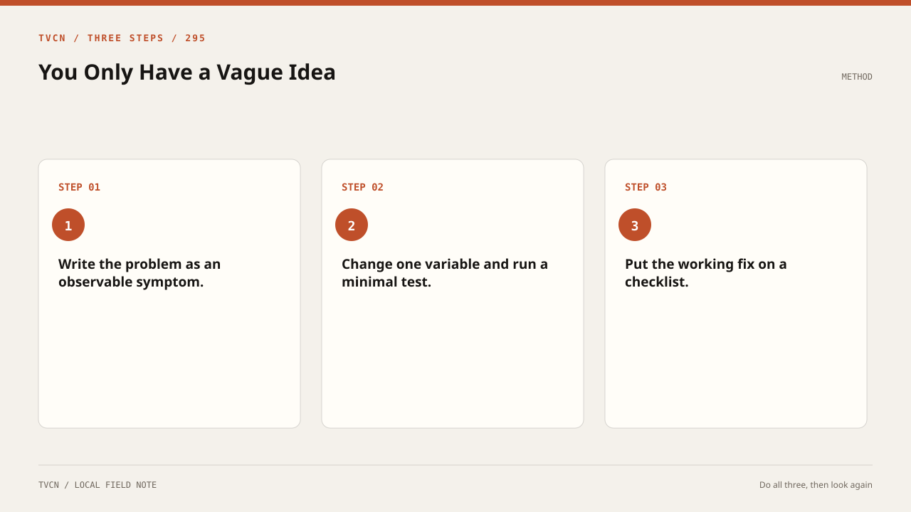

Do not write a script from a vague idea; write three lines: who wants what, what blocks them, what losing costs.

<!-- DIAGRAM_START -->
<h2>Diagram</h2>
<figure>
  
  <figcaption>Do the three steps in order, then look again at the image or file.</figcaption>
</figure>
<!-- DIAGRAM_END -->
<h2>On set</h2>

Write three sentences: who wants what, what blocks them, what they lose. If they join into one logline, start the script.

<h2>Do this</h2>

Write one sentence you can actually shoot: who wants what, what blocks them, and what they lose if they fail. Then compress it into three shots: a person, an action, a result.
<ol><li>Write three sentences, twenty words or fewer, each with a verb and a concrete object.</li><li>Pick the one you can finish in one room or one street; cut what needs a built set.</li><li>Shoot three tests: a wide for context, a medium for action, a close-up for the result. If they cut together, write scene two.</li></ol>
<h2>Avoid</h2>

Do not start with backstory and world-building; a setting you cannot shoot is not a story.

<h2>Check</h2>
<ul><li>One sentence names who wants what and what blocks them.</li><li>The three test shots cut together without voice-over.</li><li>Unshootable settings are gone; what remains fits one location.</li></ul>
