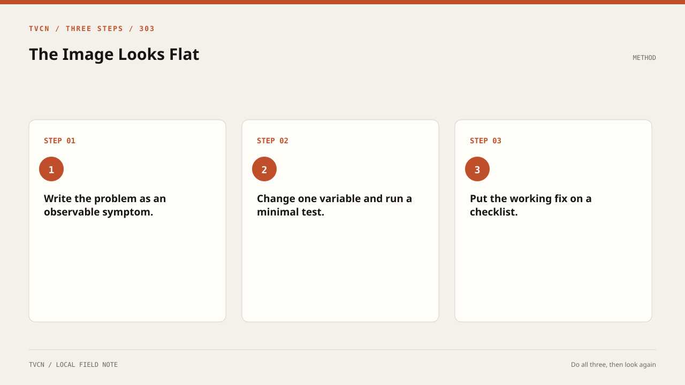

Flat images usually lack directional light and separated layers, not a better camera.

<!-- DIAGRAM_START -->
<h2>Diagram</h2>
<figure>
  
  <figcaption>Do the three steps in order, then look again at the image or file.</figcaption>
</figure>
<!-- DIAGRAM_END -->
<h2>On set</h2>

Add side light, foreground, and background layers. Move the subject one meter off the wall for depth.

<h2>Do this</h2>

A flat image is usually not the camera. Light has no direction and foreground and background are not separated. Add side light, then a foreground layer.
<ol><li>Move the key from the front to forty-five degrees to one side so the nose casts a shadow.</li><li>Put a soft foreground object near the lens: a cup, door frame, shoulder.</li><li>Move the subject at least 1.5 meters from the background so it falls out of focus.</li></ol>
<h2>Avoid</h2>

Do not fix it with contrast and sharpening; flatness is a spatial problem.

<h2>Check</h2>
<ul><li>The key is to one side and the nose casts a shadow.</li><li>A soft foreground object separates the subject from the background.</li><li>The subject stands at least 1.5 meters from the background.</li></ul>
