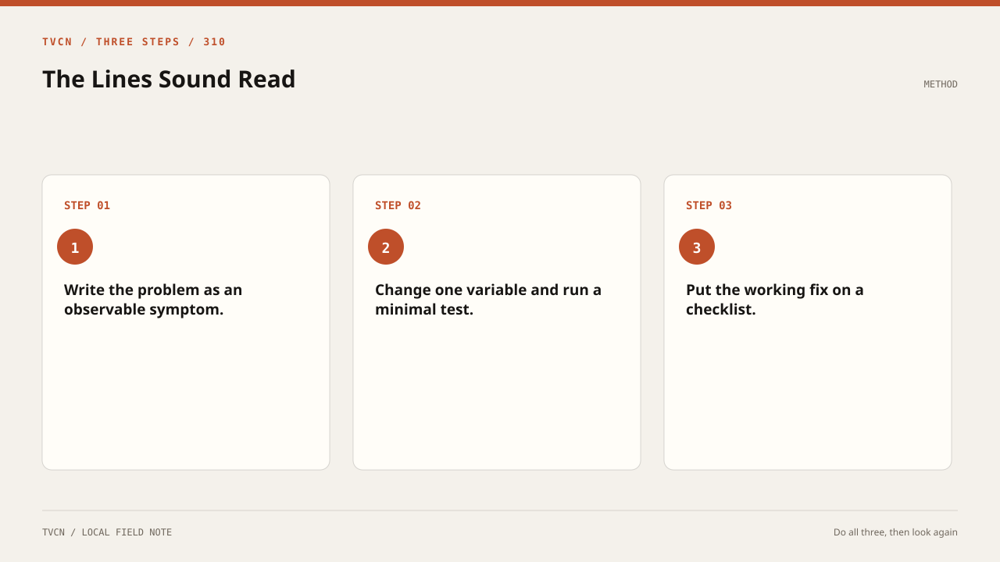

Flat lines: cut explanation, add action, and have the actor speak to a person. More adjectives will not help.

<!-- DIAGRAM_START -->
<h2>Diagram</h2>
<figure>
  
  <figcaption>Watch “Delete lines that explain; keep only want and” and “Give every line an action or object: look”; judge whether the symptom can be restated as one observable sentence.</figcaption>
</figure>
<!-- DIAGRAM_END -->
<section><h2 id="section-1">On set</h2>
Cut explanation, add action, and have the actor speak to one person. Do not add adjectives.
</section><section><h2 id="section-2">Do this</h2><ol><li>Delete lines that explain; keep only want and obstacle.</li><li>Give every line an action or object: look at someone, pick something up, walk somewhere.</li><li>Play the line to a real person, not to the air or the lens.</li></ol></section><section><h2 id="section-3">Avoid</h2>
Do not replace subtext with volume or a crying voice.
</section><section><h2 id="section-4">Three causes</h2>
For “The Lines Sound Read”, check three directions first. Change one variable, record a 30-second comparison, and see which link the change follows.

<table class="data-table"><thead><tr><th>Cause</th><th>Signal on set</th><th>Five-minute test</th></tr></thead><tbody><tr><td>Written language</td><td>Complete sentences carry too much information and sound like an essay</td><td>Break into short spoken lines; allow half-sentences</td></tr><tr><td>No intention</td><td>Every word is correct but the actor does not know what the line should change in the other person</td><td>Give one subtext: stay, leave, admit</td></tr><tr><td>No obstacle</td><td>The other character agrees immediately, so the line has nothing to push against</td><td>Let them refuse, stay silent or challenge</td></tr></tbody></table>
</section><section><h2 id="section-5">On-set diagnosis</h2><ol><li>Ask the actor to say the line in their own words; check whether the meaning survives.</li><li>Ask what the line wants from the other person. If the actor cannot answer, intention is missing.</li><li>Play the action without lines; if it works, add the lines back.</li></ol></section><section><h2 id="section-6">Fix</h2>
Flat lines are usually not a pronunciation problem; the line has no task. Make every sentence try to change the other person, then work on rhythm and stress.
<ol><li>Split long sentences and remove explanatory clauses.</li><li>Give every line an action: ask, probe, threaten, conceal.</li><li>Let the scene partner provide real resistance; do not feed the next line early.</li><li>Allow pauses and overlaps; do not wait for a clean end every time.</li></ol></section><section><h2 id="section-7">Failure cases</h2>
With “The Lines Sound Read”, these three moves make it worse. Pick one replacement action and do not change three variables at once.

<table class="data-table"><thead><tr><th>Failure</th><th>Why it gets worse</th><th>Replace with</th></tr></thead><tbody><tr><td>Add more emotion</td><td>Every line pushes and sounds less true</td><td>Set intention first, then decide delivery</td></tr><tr><td>Tell them to be natural</td><td>Natural toward what?</td><td>Give an action and an object</td></tr><tr><td>Rewrite word by word</td><td>The sentence flows but the intention is still empty</td><td>Write what each line wants to change</td></tr></tbody></table>
</section><section><h2 id="section-8">Acceptance table</h2>
Acceptance is not “it feels better”; all four must be identifiable, playable and logged.

<table class="data-table"><thead><tr><th>Check</th><th>Pass line</th><th>Log</th></tr></thead><tbody><tr><td>Spoken</td><td>The line runs in one breath and does not sound like an essay</td><td>Actor paraphrase</td></tr><tr><td>Intention</td><td>Each line names what it wants from the other person</td><td>Annotate line by line</td></tr><tr><td>Resistance</td><td>The partner reacts instead of waiting</td><td>Watch the exchange</td></tr><tr><td>Pause</td><td>At least one real pause or overlap</td><td>Review dialogue</td></tr></tbody></table>
</section><section><h2>Boundary</h2>
It does not guarantee a story. The template only orders structure; the person, obstacle and cost still need writing.
</section><section><h2>Alternative</h2>
If “Delete lines that explain; keep only want and” is not the main problem, start with the basic move behind “Give every line an action or object: look”. Upgrade only after both hold.
</section><section><h2>60-second test</h2>
Run a 60-second test with the gear you own, focused on “Delete lines that explain; keep only want and”, and record one number. If the number does not change, do not add budget.
</section><section><h2>When not to use</h2>
Do not use the template when “Delete lines that explain; keep only want and” is still unclear or “Give every line an action or object: look” is only filler. Go back to the person and the problem.
</section><section><h2>Three failures</h2><ul><li>Every beat exists, but no one makes a decision.</li><li>The middle changes location, not information.</li><li>The ending is narrated, with no visible change.</li></ul></section>
<h2>Check</h2><ul><li>Explanatory lines are gone; only want and obstacle remain.</li><li>Every line has an action or a person to play it to.</li><li>The actor speaks to a real person, not the air or the lens.</li></ul>

<!-- SOURCES_START -->
## Experience note

Experience note: this page draws on 5 client brief and project review reviews under a one- or two-to-three-person team with a fixed budget and schedule; it discusses “The Lines Sound Read”; no external laboratory test was run, and the conclusion may not transfer when conditions change.
<!-- SOURCES_END -->

