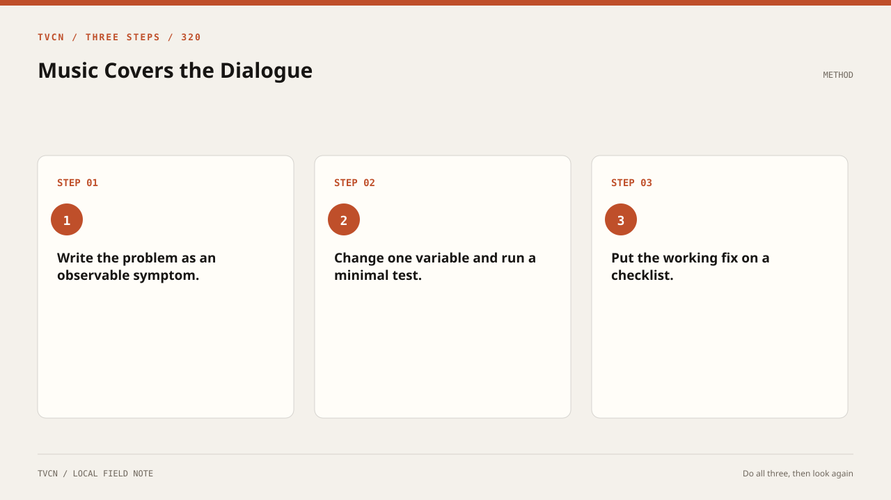

Drop music six dB, then ask whether the scene needs it at all.

<!-- DIAGRAM_START -->
<h2>Diagram</h2>
<figure>
  
  <figcaption>Do the three steps in order, then look again at the image or file.</figcaption>
</figure>
<!-- DIAGRAM_END -->
<h2>On set</h2>

Lower the music by 6 dB and ask whether it is needed at all. Dialogue first.

<h2>Do this</h2>

Music over dialogue: drop the music six dB first, then ask whether the scene needs it at all.
<ol><li>Solo the dialogue and confirm every word is audible.</li><li>Lower the music six to ten dB under dialogue, or use sidechain and automation.</li><li>If it still masks words, cut the music and let room tone carry the scene.</li></ol>
<h2>Avoid</h2>

Do not fill every silence with music; quiet is also rhythm.

<h2>Check</h2>
<ul><li>Soloed dialogue is intelligible word for word.</li><li>Music under dialogue is down six to ten dB.</li><li>If it still masks words, the music is cut and room tone carries the scene.</li></ul>
