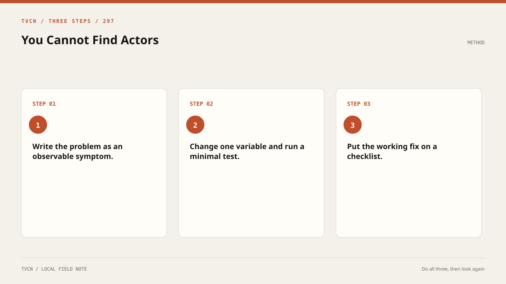

No actors? Shoot hands, backs, objects, and sound; a person can be complete without a face.

<!-- DIAGRAM_START -->
<h2>Diagram</h2>
<figure>
  
  <figcaption>Do the three steps in order, then look again at the image or file.</figcaption>
</figure>
<!-- DIAGRAM_END -->
<h2>On set</h2>

Shoot hands, backs, objects, and sound. Use voice-over or titles; a character can exist without a face.

<h2>Do this</h2>

If you cannot cast an actor, shoot hands, backs, objects, and sound. Give a real person a real task instead of asking for emotion.
<ol><li>Break the character into four shootable parts: hands, back, profile, shadow.</li><li>Find someone willing to do a real task: cook, repair, walk. Give them a concrete job.</li><li>Record breath, footsteps, and room tone while they work; let sound fill in the person.</li></ol>
<h2>Avoid</h2>

Do not ask a non-actor to “play sad.” Ask them to find keys or wait for water to boil; emotion arrives on its own.

<h2>Check</h2>
<ul><li>You have hands, back, profile, and shadow shots.</li><li>The non-actor performs a real task, not an emotion at the lens.</li><li>Breath, footsteps, and room tone carry the character.</li></ul>
