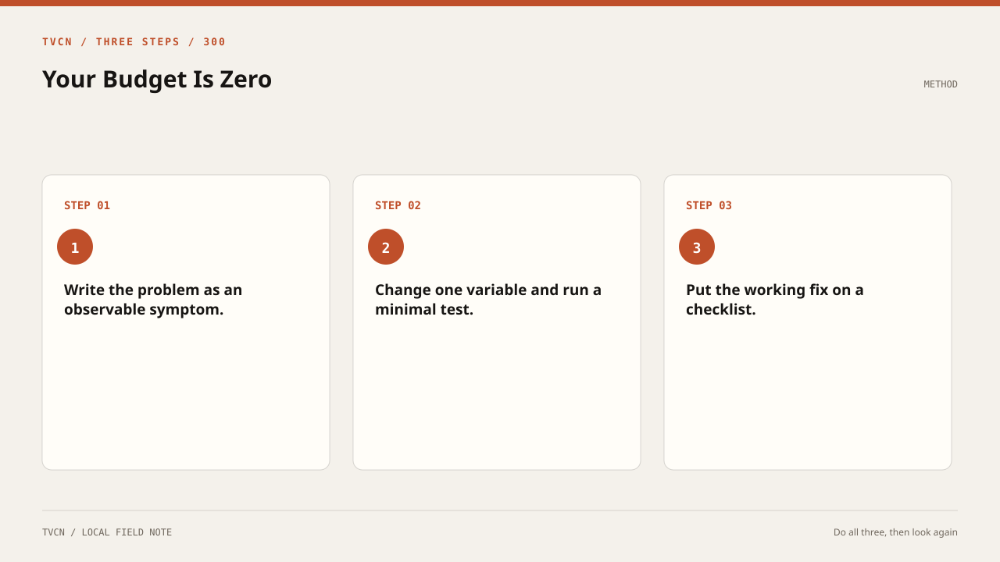

Zero budget can shoot a small space, few characters, natural light, short runtime. Compress the script to one room, two people, one afternoon; do not keep five locations and call it low budget.

<!-- DIAGRAM_START -->
<h2>Diagram</h2>
<figure>
  
  <figcaption>Watch “Reduce the script to one or two locations” and “Use available light, existing rooms, a phone, or”; judge whether the symptom can be restated as one observable sentence.</figcaption>
</figure>
<!-- DIAGRAM_END -->
<section><h2 id="section-1">With no budget, change scale, not standards</h2>
Spend on what the audience feels most: sound, actors, one key prop. Do not spread it evenly across gear.
<h2 id="section-2">Limits</h2>
Low cost is not roughness. The image can be simple, but sound must be audible and the story must change. Those are the floor, not budget lines.
<h2 id="section-3">Zero-budget projects start with what you will not do</h2>

Zero budget is not “free filming.” It is trading existing resources for a presentable result. Before starting, write three boundaries: no gear rental, no paid talent, no exterior; or keep only one. Clear boundaries make completion possible.

<table class="data-table"><thead><tr><th>Resource</th><th>What it trades for</th><th>Cost</th></tr></thead><tbody>
<tr><td>Your skill</td><td>A 30-second film for the other side</td><td>Time, not cash</td></tr>
<tr><td>Their location or product</td><td>A free set and props</td><td>A usable film in return</td></tr>
<tr><td>Platform or community</td><td>Reach, cross-promotion, feedback</td><td>Not guaranteed clients</td></tr>
</tbody></table>

<h3>The right goal for zero budget</h3>

Not “a big film,” but “one complete process.” Cut scope to one location, one camera, one finished piece, one revision. Use a phone or the camera you own; do not chase specs. Spend the time on script, location sound and edit rhythm.

<h3>Three zero-budget jobs to refuse</h3>
<ul><li>A commercial brand that says “show us the result, then we'll talk money.” That is a spec pitch, not a collaboration.</li><li>A project that asks you to front location, gear or talent costs. Zero budget is not zero cost.</li><li>Client owns all rights and asks for unlimited revisions. With no budget, lock scope even harder.</li></ul>

If you do it, sign a one-page memo: who contributes what, where the film can be used, how credit reads, and when it ends. A zero-budget project still needs a delivery date, or it never ends.
</section><section><h2 id="section-4">On set</h2>
Cut crowds, night exteriors, and vehicles. Rewrite with one room, two people, one prop.
</section><section><h2 id="section-5">Do this</h2>
With zero budget, cut scale, not structure. A simple story you can finish beats a better story you cannot afford to shoot.
<ol><li>Reduce the script to one or two locations and one or two characters.</li><li>Use available light, existing rooms, a phone, or borrowed gear.</li><li>Spend what is left on sound and a meal for the crew; finishing is the priority.</li></ol></section><section><h2 id="section-6">Avoid</h2>
Do not hide behind “we will shoot it when we have money.” Make a version you can deliver now.
</section><section>
<strong>Boundary</strong>

It does not guarantee a story. The template only orders structure; the person, obstacle and cost still need writing.
</section><section><h2>Alternative</h2>
If “Reduce the script to one or two locations” is not the main problem, start with the basic move behind “Use available light, existing rooms, a phone, or”. Upgrade only after both hold.
</section><section><h2>60-second test</h2>
Run a 60-second test with the gear you own, focused on “Reduce the script to one or two locations”, and record one number. If the number does not change, do not add budget.
</section><section><h2>When not to use</h2>
Do not use the template when “Reduce the script to one or two locations” is still unclear or “Use available light, existing rooms, a phone, or” is only filler. Go back to the person and the problem.
</section><section><h2>Three failures</h2><ul><li>Every beat exists, but no one makes a decision.</li><li>The middle changes location, not information.</li><li>The ending is narrated, with no visible change.</li></ul></section>
<h2>Check</h2><ul><li>Locations and characters are reduced to one or two.</li><li>The film is finished with available light, existing rooms, a phone, or borrowed gear.</li><li>Sound is clean, the crew ate, and the film can be delivered.</li></ul>

<!-- DEEP_DIVE_START -->
## Deep dive

<strong>About 6 minutes.</strong> Zero budget is not waiting for money. It is turning constraints into rules so the film works without gear.

### Cut what you cannot afford

List three things you cannot afford: a dolly, lights, actors, a location. Cut them from the script; do not replace them with fake shots. If you cannot cut it, move the scene into a behavior that can happen in one room.

Keep three things that cost nothing: a window, a wall, a person, an action. Write every scene around them. Ask only: what can this person do in this room right now?

### Use the light and hours you have

Use window light by day and one practical at night. Schedule the stable two hours of light. Do not buy a lamp; learn to block and bounce: black cloth on the window, a white wall as bounce, one sheet of paper as diffusion.

Use a phone or the camera you have: lock white balance, set exposure manually. Record with a wired headset mic, or put the phone close to the person. Clear sound first; style second.

### Make the limit the form

Shoot three days in one room, separated by three times of day, three shirts, three actions. Black and white, a locked camera, repeated composition can become the style. Clear limits look intentional, not poor.

The worst zero-budget film pretends to be rich. Admit the small room, the few people, the hard light; the audience trusts it more. Spend the little you have on one visible thing: a prop, a meal, a sound detail.

### Five-minute drill: one film in twenty-four hours

Choose one location, one person, one action. Shoot thirty seconds within twenty-four hours. No new gear, no narration, only available light and live sound.

After the cut, ask which three unaffordable things you removed made the story clearer. Write the answer into the rules for the next film.

### Ten zero-budget checks
<ul><li>Three unaffordable things cut first</li><li>Scenes written around the room</li><li>One window or one practical only</li><li>Shoot in the stable light window</li><li>Block and bounce instead of buying</li><li>White balance and exposure locked</li><li>Wired mic or phone close to subject</li><li>Three times of day separate the room</li><li>The limit becomes visible style</li><li>Savings spent on one visible detail</li></ul>
Zero budget is not no conditions. It is writing the conditions into the script so the film admits what it is from the first second.

<!-- DEEP_DIVE_END -->

<!-- SOURCES_START -->
## References and further reading

- [S22] [National People's Congress: Civil Code](http://www.npc.gov.cn/npc/c2/c30834/202006/t20200602_306457.html) — Accessed 2026-11-26. Used to check the terminology and public context in the opening paragraph (“Cut scale, not structure; a simple film you can finish beats”) against Statutory text on portrait rights, privacy, contracts and location rights; not a substitute for an on-set test.
- [S23] [SMPTE Standards](https://www.smpte.org/standards) — Accessed 2026-11-26. Used to check the terminology and public context in the opening paragraph (“Cut scale, not structure; a simple film you can finish beats”) against Entry point for timecode, color, cinema and signal-chain standards; not a substitute for an on-set test.
- [S02] [Copyright FAQ](https://www.wipo.int/en/web/copyright/faq-copyright) — Accessed 2026-11-26. Used to check the terminology and public context in the opening paragraph (“Cut scale, not structure; a simple film you can finish beats”) against What copyright protects, economic rights and moral rights; not a substitute for an on-set test.
- [S38] [State Taxation Administration: Official site](https://www.chinatax.gov.cn/) — Accessed 2026-11-26. Used to check the terminology and public context in the opening paragraph (“Cut scale, not structure; a simple film you can finish beats”) against Official entry for VAT, cross-border services and withholding; not a substitute for an on-set test.
<!-- SOURCES_END -->

