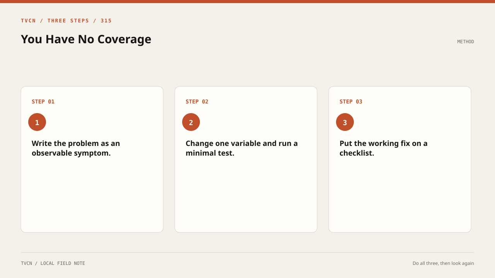

Coverage fails when every shot is one size; add wide, close, and insert.

<!-- DIAGRAM_START -->
<h2>Diagram</h2>
<figure>
  
  <figcaption>Do the three steps in order, then look again at the image or file.</figcaption>
</figure>
<!-- DIAGRAM_END -->
<h2>On set</h2>

Add a wide, a close, an insert, and a reverse. Get at least two takes of each.

<h2>Do this</h2>

You cannot cut because every setup has only one shot size. Add wides, close-ups, and inserts.
<ol><li>For each action, shoot at least a wide, a medium, and a close-up.</li><li>Add inserts: hands, feet, props, the gap in a door.</li><li>Leave three seconds of handle at the head and tail of every take.</li></ol>
<h2>Avoid</h2>

Do not shoot one long take and wrap; you will have no alternatives in the edit.

<h2>Check</h2>
<ul><li>Each action has a wide, a medium, and a close-up.</li><li>Inserts cover hands, feet, props, and door gaps.</li><li>Every take has three seconds of handle and the edit has alternatives.</li></ul>
