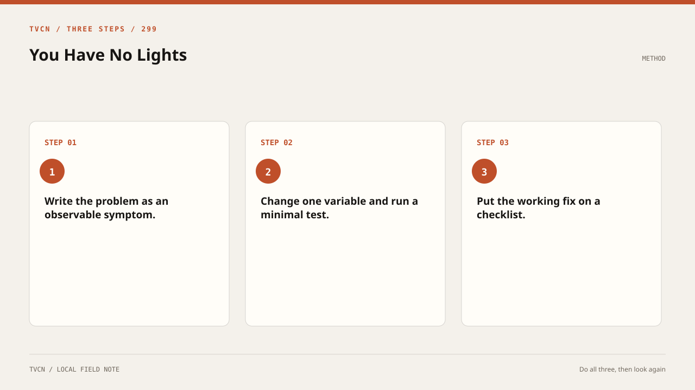

Place the same person by the window, one meter away, and with their back to it; shoot each. Choose the frame with shadow detail and a clear direction on the face. Do not use an on-camera light; it flattens every space.

<!-- DIAGRAM_START -->
<h2>Diagram</h2>
<figure>
  
  <figcaption>Watch “Turn the subject forty-five degrees to the window” and “Use a white wall or paper as a”; judge whether the symptom can be restated as one observable sentence.</figcaption>
</figure>
<!-- DIAGRAM_END -->
<section><h2 id="section-1">Use the light you already have</h2>
<ul><li><strong>Window:</strong> turn the subject sideways to the window, not toward it; it is a free large softbox.</li><li><strong>Bounce:</strong> a white wall, paper or foam board fills the shadow; try reflection before buying a light.</li><li><strong>Black flag:</strong> a dark shirt or card darkens the background and separates the subject.</li><li><strong>Practicals:</strong> a lamp, screen or torch can be in frame, but check color temperature and flicker first.</li></ul>
<h2 id="section-2">A three-position test</h2>

<h2 id="section-3">When not to force it</h2>

If the room has only mixed practicals and cannot be changed, shoot silhouette or atmosphere instead of forcing a lit face. Having no light is not a crime; pretending you do ruins the film.
</section><section><h2 id="section-4">On set</h2>
Find a window at 45 degrees, use a white wall as fill, and diffuse a phone light with tissue. Shoot half-body first.
</section><section><h2 id="section-5">Do this</h2>
With no lights, find direction first: window, white wall, reflector, phone light. Shape comes before brightness.
<ol><li>Turn the subject forty-five degrees to the window and drop the background one stop.</li><li>Use a white wall or paper as a reflector to lift the shadow a little, not to flatten it.</li><li>Diffuse a phone light with tissue and use it only for an eye light or edge; never hit the face straight on.</li></ol></section><section><h2 id="section-6">Avoid</h2>
Do not turn on every room light; light from all sides flattens the face.
</section><section><h2>Boundary</h2>
It does not guarantee a story. The template only orders structure; the person, obstacle and cost still need writing.
</section><section><h2>Alternative</h2>
If “Turn the subject forty-five degrees to the window” is not the main problem, start with the basic move behind “Use a white wall or paper as a”. Upgrade only after both hold.
</section><section><h2>60-second test</h2>
Run a 60-second test with the gear you own, focused on “Turn the subject forty-five degrees to the window”, and record one number. If the number does not change, do not add budget.
</section><section><h2>When not to use</h2>
Do not use the template when “Turn the subject forty-five degrees to the window” is still unclear or “Use a white wall or paper as a” is only filler. Go back to the person and the problem.
</section><section><h2>Three failures</h2><ul><li>Every beat exists, but no one makes a decision.</li><li>The middle changes location, not information.</li><li>The ending is narrated, with no visible change.</li></ul></section>
<h2>Check</h2><ul><li>The subject faces the window at an angle, the nose casts a shadow, and the background is a stop darker.</li><li>The shadow is lifted slightly but fabric texture is still visible.</li><li>Phone light only makes an eye light or edge; no flat bright patch on the face.</li></ul>
