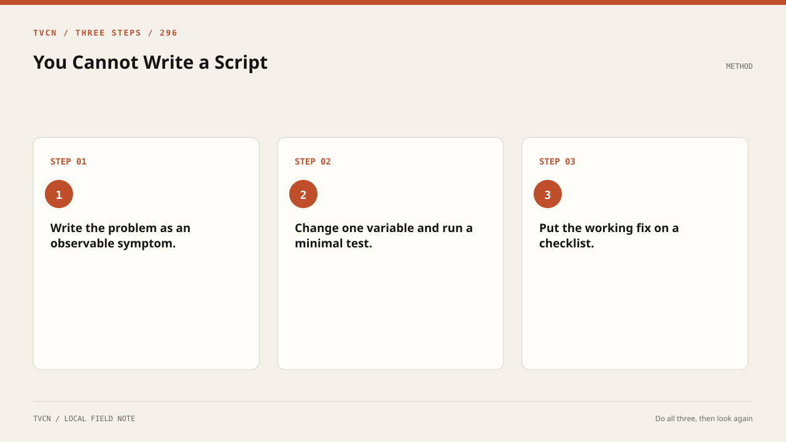

If you cannot write a script, board eight shots with one action each; action will force the lines.

<!-- DIAGRAM_START -->
<h2>Diagram</h2>
<figure>
  
  <figcaption>Do the three steps in order, then look again at the image or file.</figcaption>
</figure>
<!-- DIAGRAM_END -->
<h2>On set</h2>

Draw eight panels, one action each, no dialogue. Tell it in order; if it does not flow, change a panel.

<h2>Do this</h2>

If you cannot write a script, write an eight-panel shot board, one action per panel. Action forces dialogue, not the other way around.
<ol><li>For each panel write “who does what,” with no emotion or explanation.</li><li>Give each panel a shootable location, prop, and time.</li><li>Read the eight panels in order, cut repeated information, and add one action wherever cause and effect are missing.</li></ol>
<h2>Avoid</h2>

Do not start with pages of dialogue; lines without action play like a reading on set.

<h2>Check</h2>
<ul><li>Each of the eight panels has one action and no emotion adjectives.</li><li>Every panel has a location, prop, and time you can shoot.</li><li>Read in order, cause and effect are clear and repeats are gone.</li></ul>
