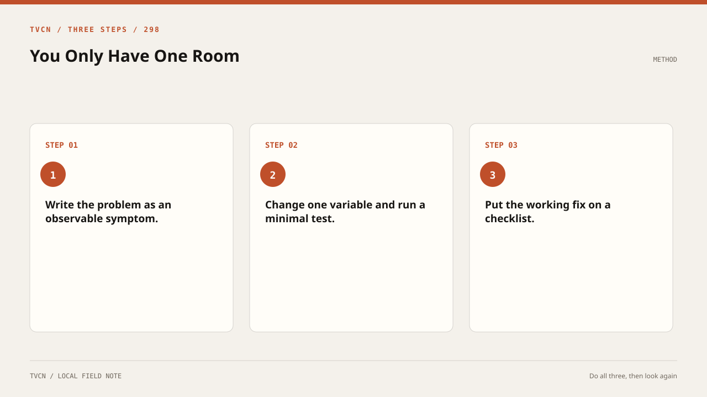

One room works if it changes once during the film: messier, emptier, darker.

<!-- DIAGRAM_START -->
<h2>Diagram</h2>
<figure>
  
  <figcaption>Do the three steps in order, then look again at the image or file.</figcaption>
</figure>
<!-- DIAGRAM_END -->
<h2>On set</h2>

Shoot the same room in three states: tidy, messy, empty. Change the space with light and props.

<h2>Do this</h2>

One room must change on screen: tidy to messy, day to dusk, full to empty. When the space changes, the story moves.
<ol><li>Shoot three empty frames from the same camera position, noting light and props.</li><li>Change the space with three actions: open a box, draw the curtain, move the chair away.</li><li>Add one close-up detail per stage so the audience sees the change.</li></ol>
<h2>Avoid</h2>

Do not only change camera positions; the audience will feel the film is circling in place.

<h2>Check</h2>
<ul><li>Three empty frames from one position show light and prop changes.</li><li>Three actions leave the space in different states: full, messy, empty.</li><li>One close-up per stage proves the change.</li></ul>
