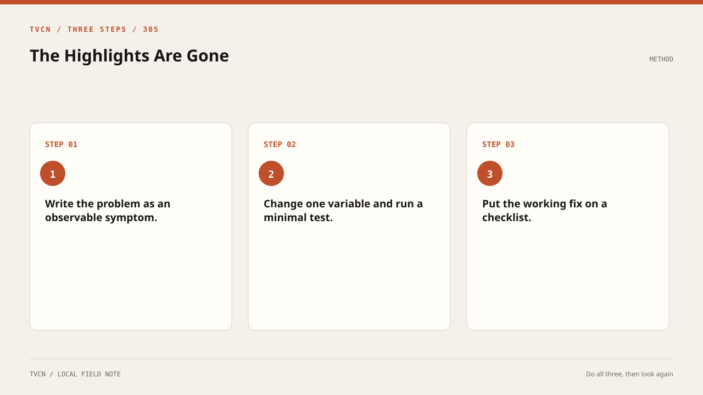

Clipped highlights: stop down a stop, add ND, and kill unnecessary practicals. Blown pixels do not return.

<!-- DIAGRAM_START -->
<h2>Diagram</h2>
<figure>
  
  <figcaption>Watch “Use ND or close the iris until highlights” and “Turn off unneeded bulbs or windows in frame”; judge whether the symptom can be restated as one observable sentence.</figcaption>
</figure>
<!-- DIAGRAM_END -->
<section><h2 id="section-1">On set</h2>
Cut a stop, add ND, and turn off practicals in frame. Clipped highlights cannot be saved.
</section><section><h2 id="section-2">Do this</h2><ol><li>Use ND or close the iris until highlights sit inside the waveform.</li><li>Turn off unneeded bulbs or windows in frame to reduce the ratio.</li><li>Check faces and sky with zebras or false color before rolling.</li></ol></section><section><h2 id="section-3">Avoid</h2>
Do not expect post to recover highlights; pure white has no detail.
</section><section><h2 id="section-4">Three causes</h2>
For “The Highlights Are Gone”, check three directions first. Change one variable, record a 30-second comparison, and see which link the change follows.

<table class="data-table"><thead><tr><th>Cause</th><th>Signal on set</th><th>Five-minute test</th></tr></thead><tbody><tr><td>No ND</td><td>At a wide aperture in daylight the shutter is maxed and highlights clip</td><td>Add 2–4 stops of ND</td></tr><tr><td>Specular highlights</td><td>Lamps, windows and metal reflect straight into the lens</td><td>Change the angle or diffuse/polarize</td></tr><tr><td>Overexposed Log</td><td>“Expose right” without a ceiling leaves no highlight detail</td><td>Keep highlights below 95%</td></tr></tbody></table>
</section><section><h2 id="section-5">On-set diagnosis</h2><ol><li>Turn on 95% zebras and look for large blinking areas; confirm with false colour.</li><li>Check whether the histogram is pinned at the right edge; clipped areas cannot be recovered.</li><li>Shoot the same shot one stop down and compare highlight texture with shadow noise.</li></ol></section><section><h2 id="section-6">Fix</h2>
Clipped highlights are not a post fix. Cut light first, then decide which highlight must survive; you cannot keep all of them.
<ol><li>Add ND or stop down; keep the shutter near 1/50 at 25p.</li><li>Change the angle on windows, tubes and metal, or diffuse the source.</li><li>Expose to the right with a third-stop margin; keep peaks below 95%.</li><li>If the highlight is the subject, underexpose the shadows a little and keep the texture.</li></ol></section><section><h2 id="section-7">Failure cases</h2>
With “The Highlights Are Gone”, these three moves make it worse. Pick one replacement action and do not change three variables at once.

<table class="data-table"><thead><tr><th>Failure</th><th>Why it gets worse</th><th>Replace with</th></tr></thead><tbody><tr><td>Pull highlights in post</td><td>They turn dead white with halos</td><td>Reduce light on set</td></tr><tr><td>Darken the whole image</td><td>Midtones die and the frame looks muddy</td><td>Lower highlights only</td></tr><tr><td>Add contrast</td><td>Highlights get harder and detail disappears</td><td>Recover highlights before contrast</td></tr></tbody></table>
</section><section><h2 id="section-8">Acceptance table</h2>
Acceptance is not “it feels better”; all four must be identifiable, playable and logged.

<table class="data-table"><thead><tr><th>Check</th><th>Pass line</th><th>Log</th></tr></thead><tbody><tr><td>Highlights</td><td>Lamps and windows have texture, not pure white</td><td>Zebra/false colour</td></tr><tr><td>Shutter</td><td>Motion blur is natural, no flicker</td><td>25p at 1/50</td></tr><tr><td>Skin</td><td>The face is not overexposed</td><td>Waveform 60–75%</td></tr><tr><td>Shadows</td><td>Usable detail remains</td><td>Review the shadow side</td></tr></tbody></table>
</section><section><h2>Boundary</h2>
It does not guarantee a story. The template only orders structure; the person, obstacle and cost still need writing.
</section><section><h2>Alternative</h2>
If “Use ND or close the iris until highlights” is not the main problem, start with the basic move behind “Turn off unneeded bulbs or windows in frame”. Upgrade only after both hold.
</section><section><h2>60-second test</h2>
Run a 60-second test with the gear you own, focused on “Use ND or close the iris until highlights”, and record one number. If the number does not change, do not add budget.
</section><section><h2>When not to use</h2>
Do not use the template when “Use ND or close the iris until highlights” is still unclear or “Turn off unneeded bulbs or windows in frame” is only filler. Go back to the person and the problem.
</section><section><h2>Three failures</h2><ul><li>Every beat exists, but no one makes a decision.</li><li>The middle changes location, not information.</li><li>The ending is narrated, with no visible change.</li></ul></section>
<h2>Check</h2><ul><li>Highlights sit inside the waveform and the sky or window holds detail.</li><li>Unneeded bulbs or windows are off and the ratio is lower.</li><li>Face and sky are checked with zebras or false color.</li></ul>

<!-- SOURCES_START -->
## Experience note

Experience note: this page draws on 7 client brief and project review reviews under a one- or two-to-three-person team with a fixed budget and schedule; it discusses “The Highlights Are Gone”; no external laboratory test was run, and the conclusion may not transfer when conditions change.
<!-- SOURCES_END -->

