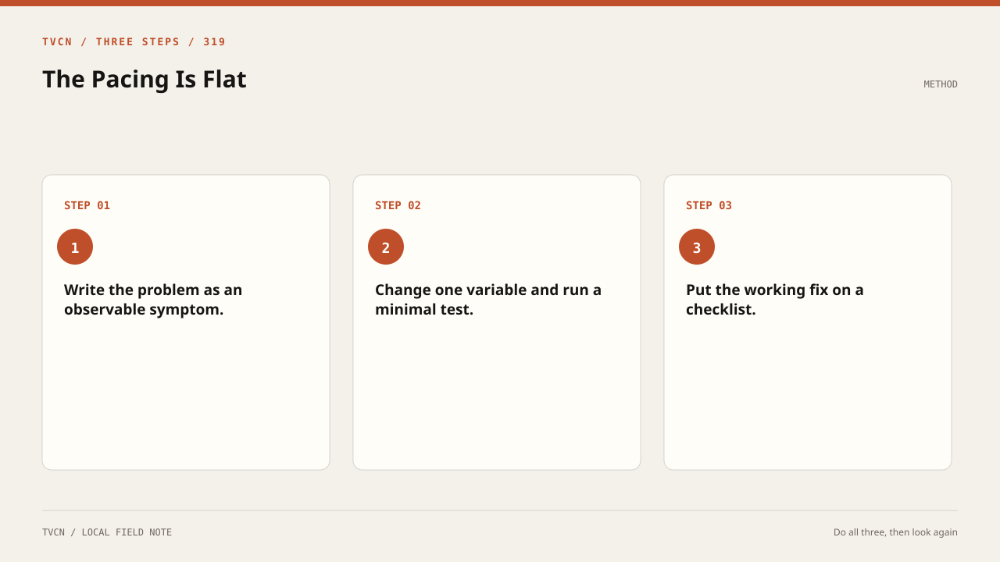

Flat pacing: change shot lengths. Three shots of the same length in a row lose the audience.

<!-- DIAGRAM_START -->
<h2>Diagram</h2>
<figure>
  
  <figcaption>Watch “List the shot lengths in a scene and” and “Shorten before information, hold longer after a reaction.”; judge whether the symptom can be restated as one observable sentence.</figcaption>
</figure>
<!-- DIAGRAM_END -->
<section><h2 id="section-1">On set</h2>
If three shots run the same length, change one: long, short, long. Give the audience air.
</section><section><h2 id="section-2">Do this</h2><ol><li>List the shot lengths in a scene and avoid three identical ones in a row.</li><li>Shorten before information, hold longer after a reaction.</li><li>Build rhythm from action and sound, not a cut on every music beat.</li></ol></section><section><h2 id="section-3">Avoid</h2>
Do not quick-cut the whole film; without breathing room, the audience tires.
</section><section><h2 id="section-4">Three causes</h2>
For “The Pacing Is Flat”, check three directions first. Change one variable, record a 30-second comparison, and see which link the change follows.

<table class="data-table"><thead><tr><th>Cause</th><th>Signal on set</th><th>Five-minute test</th></tr></thead><tbody><tr><td>Equal shot lengths</td><td>The scene feels like a slideshow</td><td>Mark the information change every ten seconds</td></tr><tr><td>No reactions</td><td>Action happens without anyone’s attitude toward it</td><td>Add a reaction after each action</td></tr><tr><td>Constant music</td><td>The score stays at one level and the cut never breathes</td><td>Let music enter and leave at turns</td></tr></tbody></table>
</section><section><h2 id="section-5">On-set diagnosis</h2><ol><li>Watch without music and mark what the audience learns every ten seconds.</li><li>Count shots and average length per scene; identical lengths flatten rhythm.</li><li>Find three places that can hold for one second: action completion, line landing, reaction.</li></ol></section><section><h2 id="section-6">Fix</h2>
Rhythm is not shorter shots; it is information increasing and decreasing. Cut on action first, then let a pause carry pressure.
<ol><li>Cut on action: a door opens, a cup lands, a body turns; the completion point is the cut.</li><li>Shorten empty shots to the one second that carries information; never use them as filler.</li><li>Hold one pause before each turn so the audience expects the next line.</li><li>Bring music in or out at turns; do not wallpaper the whole scene.</li></ol></section><section><h2 id="section-7">Failure cases</h2>
With “The Pacing Is Flat”, these three moves make it worse. Pick one replacement action and do not change three variables at once.

<table class="data-table"><thead><tr><th>Failure</th><th>Why it gets worse</th><th>Replace with</th></tr></thead><tbody><tr><td>Speed everything up</td><td>The audience cannot read the frame and feels dizzy</td><td>Only shorten shots with no information</td></tr><tr><td>Cut every line</td><td>The performance breaks into fragments</td><td>Let one action span two shots</td></tr><tr><td>Push with music</td><td>The score peaks but the picture has not changed</td><td>Change the information first, then add music</td></tr></tbody></table>
</section><section><h2 id="section-8">Acceptance table</h2>
Acceptance is not “it feels better”; all four must be identifiable, playable and logged.

<table class="data-table"><thead><tr><th>Check</th><th>Pass line</th><th>Log</th></tr></thead><tbody><tr><td>First 30 seconds</td><td>At least three information changes</td><td>Mark each block</td></tr><tr><td>Shot lengths</td><td>Not every shot is the same length</td><td>Timeline statistics</td></tr><tr><td>Pause</td><td>At least one one-second pause carries pressure</td><td>Review the turn</td></tr><tr><td>Music</td><td>Music enters and exits; it is not continuous</td><td>Solo the music track</td></tr></tbody></table>
</section><section><h2>Boundary</h2>
This page only covers “The Pacing Is Flat”; it does not replace You Only Have a Phone, The Platform Rejected It, 16mm: Cinema Left the Theater. When the problem belongs to one of those pages, use that page instead of adding more parameters here.
</section><section><h2>Alternative</h2>
If “List the shot lengths in a scene and avoid three identical ones in a row” is not the main problem, start with “Shorten before information, hold longer after a reaction”; only upgrade after both hold.
</section><section><h2>60-second test</h2>
Run one 60-second test against check 1: No three consecutive shots share the same length. If check 2 (Shots shorten before information and hold after a reaction) does not change, do not add gear or budget.
</section>
<h2>Check</h2><ul><li>No three consecutive shots share the same length.</li><li>Shots shorten before information and hold after a reaction.</li><li>Rhythm comes from action and sound, not a cut on every beat.</li></ul>

<!-- SOURCES_START -->
## Experience note

Experience note:This page draws on 7 projects with one lead and a two-to-three-person crew, a fixed budget and schedule; it covers the decision order for “The Pacing Is Flat”, not an external laboratory test, multi-camera, union crews, stunts or high-risk sets.
<!-- SOURCES_END -->

