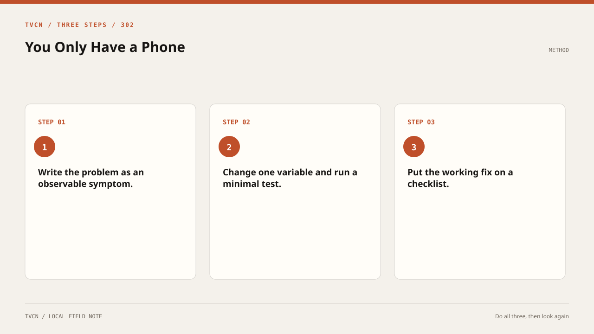

Record 30 seconds at the final position: lock exposure for one take, have someone speak normally, then play back for sound. If highlights clip, dialogue is hollow or the frame shakes, fix one cause before adding filters and transitions.

<!-- DIAGRAM_START -->
<h2>Diagram</h2>
<figure>
  
  <figcaption>Watch “Long-press to lock auto exposure and focus, then” and “Use a tripod, wall, or backpack; turn off”; judge whether the symptom can be restated as one observable sentence.</figcaption>
</figure>
<!-- DIAGRAM_END -->
<section><h2 id="section-1">Turn the phone into a controllable camera</h2>
<ul><li><strong>Exposure:</strong> lock AE/AF so the image does not pulse with the face; protect highlights and leave shadow detail for post.</li><li><strong>Sound:</strong> the built-in mic is too far away. Use a lav or shotgun; even one lav doubles intelligibility.</li><li><strong>Stability:</strong> tuck your elbows, or brace against a wall, table or bag. Do not walk with the phone held out; electronic stabilization crops and jitters.</li><li><strong>Lens:</strong> use the main camera, not digital zoom. Need a longer lens? Walk closer, do not magnify.</li></ul>
<h2 id="section-2">A thirty-second test</h2>

<h2 id="section-3">When not to use a phone</h2>

For very shallow depth of field, clean low light, telephoto compression or professional sound, a phone is not a cheaper cinema camera; it is a different medium. Do not force it to imitate one.
</section><section><h2 id="section-4">On set</h2>
Lock exposure and white balance, use a tripod or wall, and add a lav mic. Protect sound first.
</section><section><h2 id="section-5">Do this</h2>
On a phone, lock exposure and white balance first, then stabilize the body. Stability and sound matter more than the lens.
<ol><li>Long-press to lock auto exposure and focus, then pull exposure down to protect highlights.</li><li>Use a tripod, wall, or backpack; turn off stabilization modes that crop the frame.</li><li>Add a lav mic or recorder fifteen to twenty centimeters from the mouth, and record room tone separately.</li></ol></section><section><h2 id="section-6">Avoid</h2>
Do not walk and handhold; the shake makes the audience dizzy before the story starts.
</section><section><h2>Boundary</h2>
It does not guarantee a story. The template only orders structure; the person, obstacle and cost still need writing.
</section><section><h2>Alternative</h2>
If “Long-press to lock auto exposure and focus, then” is not the main problem, start with the basic move behind “Use a tripod, wall, or backpack; turn off”. Upgrade only after both hold.
</section><section><h2>60-second test</h2>
Run a 60-second test with the gear you own, focused on “Long-press to lock auto exposure and focus, then”, and record one number. If the number does not change, do not add budget.
</section><section><h2>When not to use</h2>
Do not use the template when “Long-press to lock auto exposure and focus, then” is still unclear or “Use a tripod, wall, or backpack; turn off” is only filler. Go back to the person and the problem.
</section><section><h2>Three failures</h2><ul><li>Every beat exists, but no one makes a decision.</li><li>The middle changes location, not information.</li><li>The ending is narrated, with no visible change.</li></ul></section>
<h2>Check</h2><ul><li>Exposure and white balance are locked and highlights are not blown out.</li><li>The frame is stable; no walking shake.</li><li>Dialogue is clean and there is a separate room-tone track.</li></ul>

<!-- SOURCES_START -->
## Experience note

Experience note: this page draws on 6 client brief and project review reviews under a one- or two-to-three-person team with a fixed budget and schedule; it discusses “You Only Have a Phone”; no external laboratory test was run, and the conclusion may not transfer when conditions change.
<!-- SOURCES_END -->

