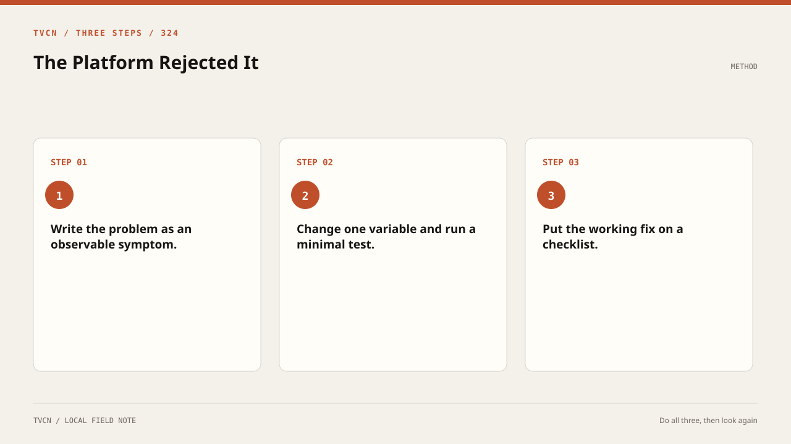

Watch the cut muted for visual risk; then listen with eyes closed for sound and claims. Compare each item with the current rule and write three columns: issue, evidence, fix.

<!-- DIAGRAM_START -->
<h2>Diagram</h2>
<figure>
  
  <figcaption>Watch “List four likely triggers: sensitive imagery, absolute claims,” and “Change one item at a time and re-upload”; judge whether the symptom can be restated as one observable sentence.</figcaption>
</figure>
<!-- DIAGRAM_END -->
<section><h2 id="section-1">Check four categories first</h2>
<ul><li><strong>Content class:</strong> violence, medical, financial, minors, politics and news each carry extra documentation. Read the platform's current rule, not last year's experience.</li><li><strong>Claims and proof:</strong> efficacy, price, comparison, expert identity. Delete absolute claims without evidence.</li><li><strong>Music and assets:</strong> commercial license or platform-only use? “Others use it” is not a license.</li><li><strong>People and privacy:</strong> likeness, voice, address, plate, minors. Get consent, or obscure and remove.</li></ul>
<h2 id="section-2">A ten-minute pre-check</h2>

<h2 id="section-3">When not to re-upload repeatedly</h2>

Uploading the same version again does not change the result and may trigger risk controls. Get the specific reason, add evidence or change the frame, then appeal. “I think it's fine” is not a fix.
</section><section><h2 id="section-4">On set</h2>
Check images, text, music, and claims. Fix one item, not the whole film.
</section><section><h2 id="section-5">Do this</h2>
A platform rejection: check image, text, music, and claims. Change one thing; do not rebuild the film.
<ol><li>List four likely triggers: sensitive imagery, absolute claims, unlicensed music, engagement bait.</li><li>Change one item at a time and re-upload to test.</li><li>Keep the rejection notice and screenshots; appeal with evidence if needed.</li></ol></section><section><h2 id="section-6">Avoid</h2>
Do not delete the whole film at once; locate the trigger first.
</section><section><h2>Boundary</h2>
It does not guarantee a story. The template only orders structure; the person, obstacle and cost still need writing.
</section><section><h2>Alternative</h2>
If “List four likely triggers: sensitive imagery, absolute claims,” is not the main problem, start with the basic move behind “Change one item at a time and re-upload”. Upgrade only after both hold.
</section><section><h2>60-second test</h2>
Run a 60-second test with the gear you own, focused on “List four likely triggers: sensitive imagery, absolute claims,”, and record one number. If the number does not change, do not add budget.
</section><section><h2>When not to use</h2>
Do not use the template when “List four likely triggers: sensitive imagery, absolute claims,” is still unclear or “Change one item at a time and re-upload” is only filler. Go back to the person and the problem.
</section><section><h2>Three failures</h2><ul><li>Every beat exists, but no one makes a decision.</li><li>The middle changes location, not information.</li><li>The ending is narrated, with no visible change.</li></ul></section>
<h2>Check</h2><ul><li>Four triggers were checked one by one: sensitive imagery, absolute claims, music, engagement bait.</li><li>One item was changed per upload test.</li><li>The rejection notice and screenshots are kept for an appeal.</li></ul>

<!-- SOURCES_START -->
## Experience note

Experience note: this page draws on 4 client brief and project review reviews under a one- or two-to-three-person team with a fixed budget and schedule; it discusses “The Platform Rejected It”; no external laboratory test was run, and the conclusion may not transfer when conditions change.
<!-- SOURCES_END -->

