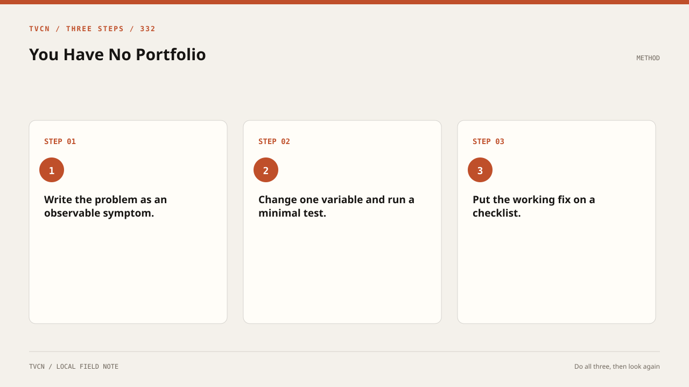

Make three 30-second proof films: a person, an object, a story.

<!-- DIAGRAM_START -->
<h2>Diagram</h2>
<figure>
  
  <figcaption>Do the three steps in order, then look again at the image or file.</figcaption>
</figure>
<!-- DIAGRAM_END -->
<h2>On set</h2>

Make three thirty-second films: people, objects, and one story. One skill per film.

<h2>Do this</h2>

No portfolio: make three thirty-second proof films. Show you can shoot a person, an object, and a story.
<ol><li>Each film proves one skill: portrait interview, product texture, or narrative turn.</li><li>Shoot with the same settings to show consistent quality.</li><li>Add one page per film: goal, method, result, failure.</li></ol>
<h2>Avoid</h2>

Do not use a travel montage as a portfolio; the client cannot see what you can do.

<h2>Check</h2>
<ul><li>Three thirty-second proof films: a person, an object, and a story.</li><li>They share one setting so quality is consistent.</li><li>Each has a one-page breakdown: goal, method, result, failure.</li></ul>

<!-- DEEP_DIVE_START -->
## Deep dive

<strong>About 7 minutes.</strong> An empty portfolio is not a lack of clients. It is a lack of three complete cases that prove you can deliver.

### Make three complete films

Do not make a one-minute reel. Make three complete films, sixty to ninety seconds each, each proving one ability: people, product, space. A reel proves you can cut; a complete film proves you can deliver.

Point all three at one niche, not weddings today and AI tomorrow. Clients do not remember “does everything”; they remember “call him for this kind of film.”

### One page per case

One page, five things: brief, constraint, key decision, result, one mistake. Do not write “the client was happy”; write what you changed and why.

Include two comparison images: before and after, or option A and B. When the client can see your judgment, they trust you to judge their project.

### Publish and reuse

Turn each case into three formats: a landscape site version, a vertical social version, and a one-page proposal PDF. Title it with the result, not “Project X.” Use one readable image on the cover.

After every new project, replace the weakest piece; do not keep adding forever. A portfolio is not a warehouse; it is how you want to be remembered.

### Five-minute drill: three-film list

Write three films you can shoot starting tomorrow: one person, one product, one space. For each, write one line: “after watching, you will believe I can do what.” If you cannot afford it, make the phone version; do not wait for gear.

Until the three exist, do not take a job that needs a fourth ability. A portfolio is not waited for; it is shot.

### When the portfolio exists

The portfolio exists when three films play end to end, each has a one-page case, the site opens, and the PDF sends. Footage and drafts do not count.

One more test: after three films, a stranger can say what you are good at and why they would call you. If not, the three still point in different directions. Keep cutting, not adding.

### Ten portfolio checks
<ul><li>Three complete films, not a reel</li><li>One ability per film</li><li>All three point at one niche</li><li>One page, five items per case</li><li>Brief and constraint written</li><li>Key decision written</li><li>Result written</li><li>One mistake written</li><li>Two comparison images</li><li>Three formats per case</li></ul>
A portfolio does not prove how much you shot; it proves you can finish three films inside constraints.

<!-- DEEP_DIVE_END -->
