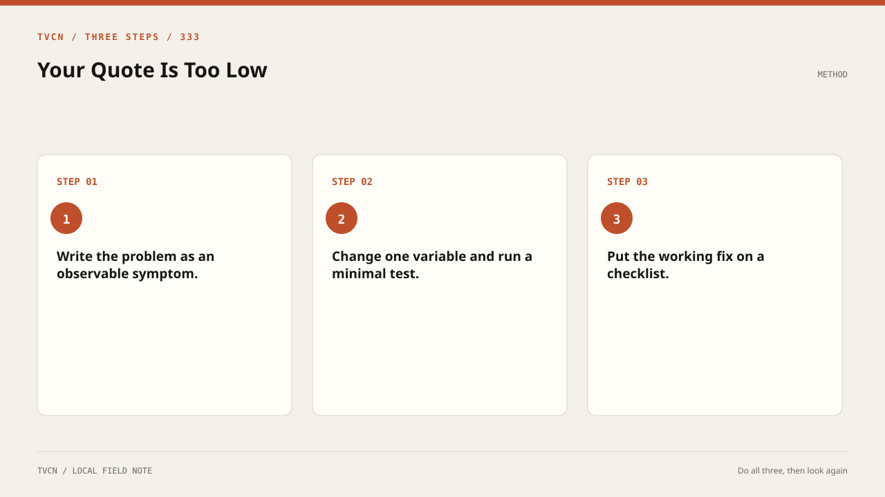

Split the quote into four: days, gear, post, licensing. Low quotes count only the shoot day, missing prep, revisions, delivery and archiving—plus gear depreciation and software subscriptions.

<!-- DIAGRAM_START -->
<h2>Diagram</h2>
<figure>
  
  <figcaption>Watch “Calculate break-even: days times day rate plus gear,” and “Add ten to twenty percent risk, and state”; judge whether the symptom can be restated as one observable sentence.</figcaption>
</figure>
<!-- DIAGRAM_END -->
<section><h2 id="section-1">Low quotes usually miss three costs</h2>
Calculate the break-even line before profit. A job below break-even costs more to take than refuse.
<h2 id="section-2">Limits</h2>
Do not comfort yourself with “I will raise prices later.” The first client locks expectations at the low price; raising it later requires explaining value again, not sending a message.
<h2 id="section-3">A quote is not a number; it is three levels of risk</h2>

The difference between ¥3,000 and ¥30,000 for the same 60-second film is not “expensive or cheap.” It is who absorbs changes, delays and rights. Split the quote into three tiers so the client knows what the money buys.

<table class="data-table"><thead><tr><th>Tier</th><th>Fits</th><th>Includes</th><th>Excludes</th></tr></thead><tbody>
<tr><td>Execution</td><td>Locked script, one location, one shoot</td><td>One shoot day, one edit, basic subtitles</td><td>Script changes, pickups, voice-over, music rights</td></tr>
<tr><td>Standard</td><td>Needs a proposal, two locations, two revisions</td><td>Treatment, storyboard, two shoot days, two revisions</td><td>Talent, location fees, specialty gear</td></tr>
<tr><td>Full package</td><td>Brand needs multi-platform delivery in one go</td><td>Concept to delivery, rights clearance, three aspect ratios</td><td>Media spend, creators, platform fees</td></tr>
</tbody></table>

<h3>Find the break-even line before any discount</h3>

Add shoot days, post days, gear rental, travel, tax and a 10% contingency, then divide by deliverable days. That is the minimum you must recover per day. Below it, a discount is not generosity; it is borrowing from a future job. A discount can come out of profit, never out of cost.

<h3>Put payment milestones in the quote</h3>
<ol><li>50% after script or storyboard approval, before the shoot. No money, no camera.</li><li>30% after rough-cut approval, 20% before final delivery. Final files leave only after the watermarked cut is approved.</li><li>Client-caused delays bill as extra shoot days; weather and force majeure are separate, not hidden inside “revisions.”</li></ul>

End the quote with one line: <strong>“Based on one script, two locations and two revisions; additional work is quoted separately.”</strong> That sentence does more than any verbal promise.
</section><section><h2 id="section-4">On set</h2>
Price days, gear, post, and revisions. Low rates drive good clients away.
</section><section><h2 id="section-5">Do this</h2>
A quote that is too low: count days, gear, post, and revisions. Low prices drive good clients away.
<ol><li>Calculate break-even: days times day rate plus gear, location, post, and tax.</li><li>Add ten to twenty percent risk, and state revision rounds and overtime.</li><li>Offer three tiers: basic, standard, rush. Let the client choose scope, not cut the rate.</li></ol></section><section><h2 id="section-6">Avoid</h2>
Do not say “let me win it first”; the low price becomes the new standard.
</section><aside class="regional-note">
<strong>Regional note for US / UK / EU readers</strong>

This English page keeps mainland-China examples where they are part of the method. Read platform names as examples, not as the only market: Douyin ↔ TikTok/Reels, Bilibili ↔ YouTube, Xiaohongshu ↔ Instagram/Pinterest; RMB figures are not converted here. Contracts, tax, insurance and consent rules differ by market; use the local currency and local counsel before signing or invoicing.
</aside><section>
<strong>Boundary</strong>

It does not guarantee a story. The template only orders structure; the person, obstacle and cost still need writing.
</section><section><h2>Alternative</h2>
If “Calculate break-even: days times day rate plus gear,” is not the main problem, start with the basic move behind “Add ten to twenty percent risk, and state”. Upgrade only after both hold.
</section><section><h2>60-second test</h2>
Run a 60-second test with the gear you own, focused on “Calculate break-even: days times day rate plus gear,”, and record one number. If the number does not change, do not add budget.
</section><section><h2>When not to use</h2>
Do not use the template when “Calculate break-even: days times day rate plus gear,” is still unclear or “Add ten to twenty percent risk, and state” is only filler. Go back to the person and the problem.
</section><section><h2>Three failures</h2><ul><li>Every beat exists, but no one makes a decision.</li><li>The middle changes location, not information.</li><li>The ending is narrated, with no visible change.</li></ul></section>
<h2>Check</h2><ul><li>Break-even is calculated: days times day rate plus gear, location, post, and tax.</li><li>Ten to twenty percent risk is added, with revision rounds and overtime stated.</li><li>Three tiers let the client choose scope; the rate is not cut.</li></ul>

<!-- DEEP_DIVE_START -->
## Deep dive

<strong>About 7 minutes.</strong> A low quote is not competitiveness. It is giving away your future revisions, gear, and hours for free.

### Find the cost floor

Write the real cost of one day: shoot days, gear depreciation or rental, software, insurance, transport, tax, contingency. Add profit after that. A quote without profit is not cheap; it is borrowing money to do the job.

Do not use “what others charge” as the only reference; their crew, gear, and scope differ. First count how many days your scope actually takes.

### Price the usage

Organic, paid media, territory, term, exclusivity: five separate lines. The client buys usage, not just shoot days. One year of media and one month are not the same price.

Revision rounds, rush, extra aspect ratios, and source files each get a line. Do not hide them inside “included,” or every add-on eats your margin.

### Negotiate scope, not rate

If the budget is low, remove locations, cameras, versions, shoot days. Do not halve the day rate. Cutting the rate teaches every future client that this is your price.

Put deposit, balance, and cancellation in the contract; cancellation pays for time already spent. A low quote collected late is worse than a fair quote collected on time.

### Five-minute drill: one cost sheet

Write a three-day project: people per day, gear, post hours, tax, insurance. Get a floor price, add twenty percent profit, and compare it with your old quote.

Turn the difference into a scope note; do not nervously delete it. The client can decline, but you should not buy an unfinished project with a low price.

### Ten quoting checks
<ul><li>Cost floor includes gear, software, insurance, tax</li><li>Profit added separately</li><li>Workload counted in shoot days</li><li>Five usage lines separated</li><li>Organic and paid media priced differently</li><li>Revision rounds itemized</li><li>Rush and extra ratios itemized</li><li>Source files itemized</li><li>Negotiate scope, not day rate</li><li>Deposit, balance, cancellation in contract</li></ul>
A low price buys a one-time client. A fair price buys someone who comes back.

<!-- DEEP_DIVE_END -->
