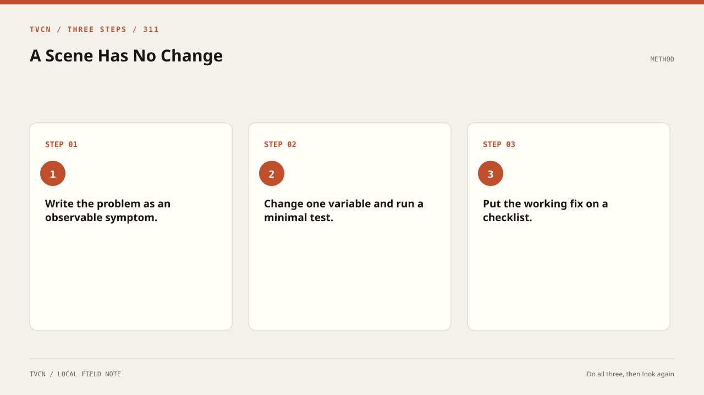

If a scene changes nothing, cut it or let someone gain or lose something.

<!-- DIAGRAM_START -->
<h2>Diagram</h2>
<figure>
  
  <figcaption>Do the three steps in order, then look again at the image or file.</figcaption>
</figure>
<!-- DIAGRAM_END -->
<h2>On set</h2>

Make someone gain or lose something. If nothing changes, cut the scene.

<h2>Do this</h2>

If a scene does not change, cut it, or let someone gain or lose something.
<ol><li>Write the state at the start and the state at the end; they must differ.</li><li>Take an object away, close a door, or say the line that changes the relationship.</li><li>If the state is unchanged, cut the scene and fold its information into the next one.</li></ol>
<h2>Avoid</h2>

Do not keep a static scene alive with “mood.”

<h2>Check</h2>
<ul><li>The start and end states are written down and they differ.</li><li>An object, a door, or a line changes the relationship.</li><li>If the state did not change, the scene is cut or merged.</li></ul>
