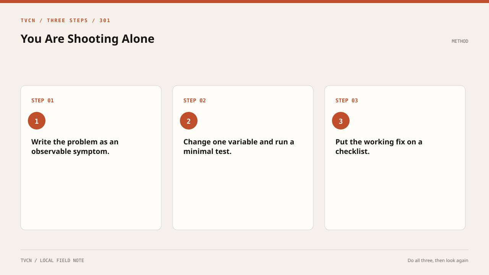

Use a locked camera and continuous action; do not act, operate, and pull focus at once.

<!-- DIAGRAM_START -->
<h2>Diagram</h2>
<figure>
  
  <figcaption>Do the three steps in order, then look again at the image or file.</figcaption>
</figure>
<!-- DIAGRAM_END -->
<h2>On set</h2>

Lock the camera, shoot your blocking and action, then shoot the empty frame. Do not act and pull focus at once.

<h2>Do this</h2>

Shooting alone means locked-off camera and continuous action. Do not act, operate, and pull focus at the same time.
<ol><li>Shoot the empty frame and the wide first, then lock the camera down.</li><li>Check framing on a monitor, pre-focus, then walk into position and do the action.</li><li>Shoot the same action three times: wide, medium, close-up. Cut them together later.</li></ol>
<h2>Avoid</h2>

Do not handhold and follow yourself; focus and framing will drift.

<h2>Check</h2>
<ul><li>The camera is locked and the empty frame and wide are shot first.</li><li>Each action has a wide, medium, and close-up take.</li><li>Focus is set before the walk; the lens does not hunt.</li></ul>

<!-- DEEP_DIVE_START -->
## Deep dive

<strong>About 6 minutes.</strong> Shooting alone is not doing three jobs at once. It is cutting the shots down to what one person can control.

### Fewer setups, fewer actions

One camera, one action, one take. Do not combine a move, a zoom, and blocking in the same shot. Each shot delivers one piece of information: space, relationship, reaction, or detail.

Shoot for the edit: wide for space, medium for action, close for reaction, insert for hands or prop. Get at least two takes per size; do not move on after one.

### Separate monitoring from sound

Use a tripod and a phone as monitor; do not hold the camera and the script at once. Record sound separately, clap at the head, and listen for ten seconds after the take. One person can run dual-system.

If you only have the camera mic, get the camera close, turn off the air conditioner and close the window. Do not plan to save dialogue with noise reduction; what you cannot hear on set will not come back in post.

### Shoot enough coverage

Shoot the same action three ways: normal speed, slower, hands only. That gives the edit choices. Do not shoot one perfect take; the perfect one is often unusable.

After each take check three things: focus, exposure, sound. If one is broken, reshoot immediately. For a solo shooter, the most expensive mistake is coming back for pickups.

### Five-minute drill: one person, three shots

On a tripod, shoot three shots: a wide, a hand detail, a reaction. One action each, no zoom. Cut them into fifteen seconds on the phone and check for space, action, and reaction.

Add whichever is missing, then put the person in frame. When shooting alone, make sure it can be cut before making it beautiful.

### When the solo shoot is done

Done does not mean every shot is perfect. It means every shot can cut: the wide establishes space, the medium shows action, the close reads reaction, the insert connects detail. If one size is missing, shoot it; do not force the same take to do the job.

Before wrapping, play the material back by scene: dialogue clear, focus holding, every take backed up. When all three pass, the shoot is done. For a solo shooter, the wrap check is worth more than ten extra takes.

### Ten solo-shoot checks
<ul><li>One camera, one piece of information</li><li>At least two takes per size</li><li>Wide, medium, close, insert covered</li><li>Tripod plus phone monitor</li><li>Sound recorded separately</li><li>Clap at the head</li><li>Listen for ten seconds</li><li>Same action shot three ways</li><li>Focus, exposure, sound checked</li><li>Cuttable first, beautiful second</li></ul>
Shooting alone is not heroics. It is reducing every shot to what one person can actually control at once.

<!-- DEEP_DIVE_END -->
