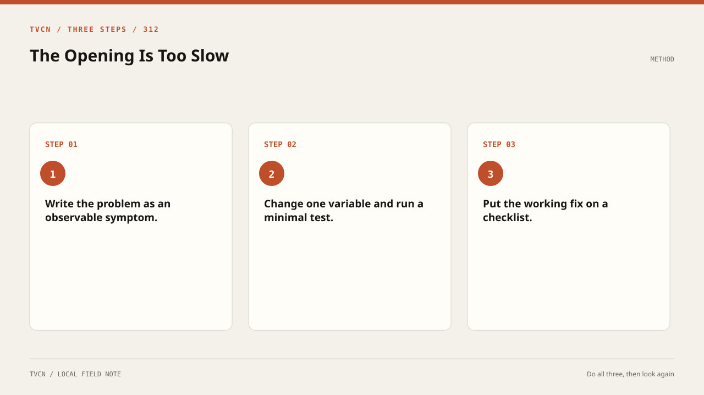

Show only the first eight seconds to someone who has not seen it, muted, then ask: who did you see, what did they want, what blocked them? If they cannot answer, the opening has not started. Do not use music or titles to supply the answer.

<!-- DIAGRAM_START -->
<h2>Diagram</h2>
<figure>
  
  <figcaption>Watch “Find the first shot where the character must” and “Split the backstory into two or three beats”; judge whether the symptom can be restated as one observable sentence.</figcaption>
</figure>
<!-- DIAGRAM_END -->
<section><h2 id="section-1">What happens in the first eight seconds?</h2>
<ul><li><strong>Only atmosphere:</strong> the opening is a wide shot, titles and music, and nobody wants anything yet. Move the first person with a goal earlier.</li><li><strong>Only explanation:</strong> narration explains backstory while nothing happens. Delete it and replace it with a visible action.</li><li><strong>Late conflict:</strong> the character meets the obstacle after 30 seconds. Put the obstacle in the first shot.</li></ul>
<h2 id="section-3">When not to speed up</h2>

If the character is not established, speeding up only makes it less clear. Add an action or one informative line before discussing pace.
</section><section><h2 id="section-4">On set</h2>
Cut the first thirty seconds and start where the character is already doing something. Add context later.
</section><section><h2 id="section-5">Do this</h2>
A slow opening: cut the first thirty seconds and start where the character is already doing something. Backstory can come later.
<ol><li>Find the first shot where the character must act, and start there.</li><li>Split the backstory into two or three beats and hide them inside later actions.</li><li>Keep only one question and one action in the first thirty seconds; no world-building.</li></ol></section><section><h2 id="section-6">Avoid</h2>
Do not narrate the backstory in voice-over or titles; the audience came to watch action.
</section><section><h2>Boundary</h2>
This page only covers “The Opening Is Too Slow”; it does not replace The Subtitles Are Hard to Read, The Thumbnail Gets No Clicks, 16mm: Cinema Left the Theater. When the problem belongs to one of those pages, use that page instead of adding more parameters here.
</section><section><h2>Alternative</h2>
If “The film starts where the character is already doing something” is not the main problem, start with “The first thirty seconds hold one question and one action”; only upgrade after both hold.
</section><section><h2>60-second test</h2>
Run one 60-second test against check 1: The film starts where the character is already doing something. If check 2 (The first thirty seconds hold one question and one action) does not change, do not add gear or budget.
</section>
<h2>Check</h2><ul><li>The film starts where the character is already doing something.</li><li>The first thirty seconds hold one question and one action.</li><li>Backstory is split into two or three beats inside later actions.</li></ul>

<!-- SOURCES_START -->
## Experience note

Experience note:This page draws on 3 projects with one lead and a two-to-three-person crew, a fixed budget and schedule; it covers the decision order for “The Opening Is Too Slow”, not an external laboratory test, multi-camera, union crews, stunts or high-risk sets.
<!-- SOURCES_END -->

