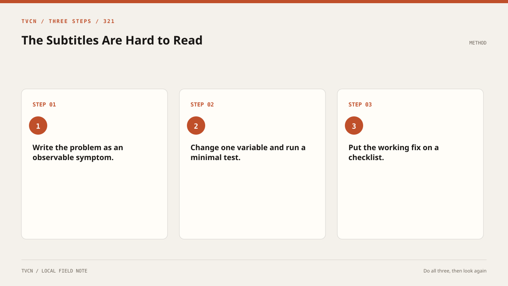

Shrink the cut to phone width, set brightness to 50%, and watch muted for 30 seconds. Can you read without pausing? Then switch to the brightest shot and confirm the captions still hold.

<!-- DIAGRAM_START -->
<h2>Diagram</h2>
<figure>
  
  <figcaption>Watch “Keep each line to twelve to sixteen Chinese” and “Place subtitles above the safe area, clear of”; judge whether the symptom can be restated as one observable sentence.</figcaption>
</figure>
<!-- DIAGRAM_END -->
<section><h2 id="section-1">Check four things</h2>
<ul><li><strong>Line length:</strong> over 18 Chinese characters, or two languages on one line. Split the sentence; do not shrink the type.</li><li><strong>Contrast:</strong> white type over sky, a white wall or a bright face. Add a translucent plate, outline or shadow; readability first.</li><li><strong>Duration:</strong> one sentence held for 0.8 seconds. Target 4–6 Chinese characters per second and split long lines.</li><li><strong>Safe area:</strong> captions on the bottom edge get covered by platform UI. Move them inside the lower 10% of frame height.</li></ul>
<h2 id="section-2">A phone test</h2>

<h2 id="section-3">When not to ship auto-captions</h2>

Names, technical terms, dialect, numbers and negation are where auto-captions fail. Without human review, do not deliver. One wrong character makes viewers doubt the whole film.
</section><section><h2 id="section-4">On set</h2>
Cut words, raise contrast, and avoid mouths and hands. Keep each line under 16 characters.
</section><section><h2 id="section-5">Do this</h2>
Hard-to-read subtitles: cut words, raise contrast, and keep them off mouths and hands. Heavy outlines are not the fix.
<ol><li>Keep each line to twelve to sixteen Chinese characters or thirty-two to forty-two English characters, two lines maximum.</li><li>Place subtitles above the safe area, clear of mouths, hands, and platform UI.</li><li>Use a subtle background or light shadow for contrast; do not outline until the text blurs.</li></ol></section><section><h2 id="section-6">Avoid</h2>
Do not transcribe every word; subtitles are a guardrail, not a transcript.
</section><aside class="regional-note">
<strong>Regional note for US / UK / EU readers</strong>

This English page keeps mainland-China examples where they are part of the method. Read platform names as examples, not as the only market: Douyin ↔ TikTok/Reels, Bilibili ↔ YouTube, Xiaohongshu ↔ Instagram/Pinterest; RMB figures are not converted here. Contracts, tax, insurance and consent rules differ by market; use the local currency and local counsel before signing or invoicing.
</aside><section><h2>Boundary</h2>
It does not guarantee a story. The template only orders structure; the person, obstacle and cost still need writing.
</section><section><h2>Alternative</h2>
If “Keep each line to twelve to sixteen Chinese” is not the main problem, start with the basic move behind “Place subtitles above the safe area, clear of”. Upgrade only after both hold.
</section><section><h2>60-second test</h2>
Run a 60-second test with the gear you own, focused on “Keep each line to twelve to sixteen Chinese”, and record one number. If the number does not change, do not add budget.
</section><section><h2>When not to use</h2>
Do not use the template when “Keep each line to twelve to sixteen Chinese” is still unclear or “Place subtitles above the safe area, clear of” is only filler. Go back to the person and the problem.
</section><section><h2>Three failures</h2><ul><li>Every beat exists, but no one makes a decision.</li><li>The middle changes location, not information.</li><li>The ending is narrated, with no visible change.</li></ul></section>
<h2>Check</h2><ul><li>Each line is twelve to sixteen Chinese characters or thirty-two to forty-two English characters, two lines maximum.</li><li>Subtitles sit above the safe area, clear of mouths, hands, and platform UI.</li><li>A subtle background or light shadow adds contrast without blurring the type.</li></ul>
