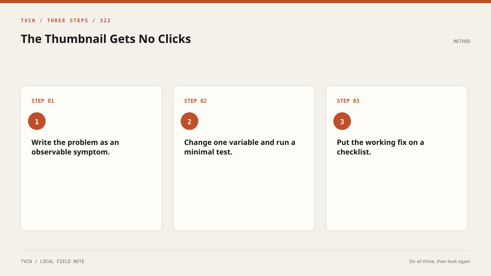

Place three candidates side by side at phone width, cover the titles, and look only at the images: can you say what it is about in three seconds? Then reveal the title and check that image and words tell the same story. Pick the one that needs no explanation. When not to bait A thumbnail can be specific, but must not promise what the video lacks. One bait click buys long-term distrust, and platforms punish it through retention and negative feedback.

<!-- DIAGRAM_START -->
<h2>Diagram</h2>
<figure>
  
  <figcaption>Watch “Choose a frame with a person, an action,” and “Scale the subject to at least a third”; judge whether the symptom can be restated as one observable sentence.</figcaption>
</figure>
<!-- DIAGRAM_END -->
<section><h2 id="section-1">Is it unseen or unclicked?</h2>
<ul><li><strong>Distribution:</strong> the platform did not show it to the right audience. Check publish time, title terms and first frame before redesigning the image.</li><li><strong>Legibility:</strong> at 120px wide the subject disappears. Crop out the background; keep one face, one object or one action.</li><li><strong>Mismatch:</strong> the thumbnail promises something the video does not deliver. Viewers leave immediately and the damage compounds.</li><li><strong>Contrast:</strong> face and background share a tone, or type sits on a busy pattern. Use a solid block or vignette to separate the subject.</li></ul>
<h2 id="section-2">A phone-size test</h2>

Place three candidates side by side at phone width, cover the titles, and look only at the images: can you say what it is about in three seconds? Then reveal the title and check that image and words tell the same story. Pick the one that needs no explanation.

<h2 id="section-3">When not to bait</h2>

A thumbnail can be specific, but must not promise what the video lacks. One bait click buys long-term distrust, and platforms punish it through retention and negative feedback.
</section><section><h2 id="section-4">On set</h2>
Show a face in action: who is doing what, with what result. It must read at 200 pixels.
</section><section><h2 id="section-5">Do this</h2>
A weak thumbnail is usually unclear, not ugly. Show a face doing something.
<ol><li>Choose a frame with a person, an action, and contrast; no empty scenery.</li><li>Scale the subject to at least a third of the frame and darken the background.</li><li>Shrink it to phone size and check in three seconds: can you say who is doing what?</li></ol></section><section><h2 id="section-6">Avoid</h2>
Do not pile on giant text and arrows; the thumbnail tells a story before it shows style.
</section><section><h2>Boundary</h2>
It does not guarantee a story. The template only orders structure; the person, obstacle and cost still need writing.
</section><section><h2>Alternative</h2>
If “Choose a frame with a person, an action,” is not the main problem, start with the basic move behind “Scale the subject to at least a third”. Upgrade only after both hold.
</section><section><h2>60-second test</h2>
Run a 60-second test with the gear you own, focused on “Choose a frame with a person, an action,”, and record one number. If the number does not change, do not add budget.
</section><section><h2>When not to use</h2>
Do not use the template when “Choose a frame with a person, an action,” is still unclear or “Scale the subject to at least a third” is only filler. Go back to the person and the problem.
</section><section><h2>Three failures</h2><ul><li>Every beat exists, but no one makes a decision.</li><li>The middle changes location, not information.</li><li>The ending is narrated, with no visible change.</li></ul></section>
<h2>Check</h2><ul><li>The thumbnail has a person, an action, and contrast; it is not empty scenery.</li><li>The subject fills at least a third and the background is darker.</li><li>At phone size, three seconds is enough to say who is doing what.</li></ul>
