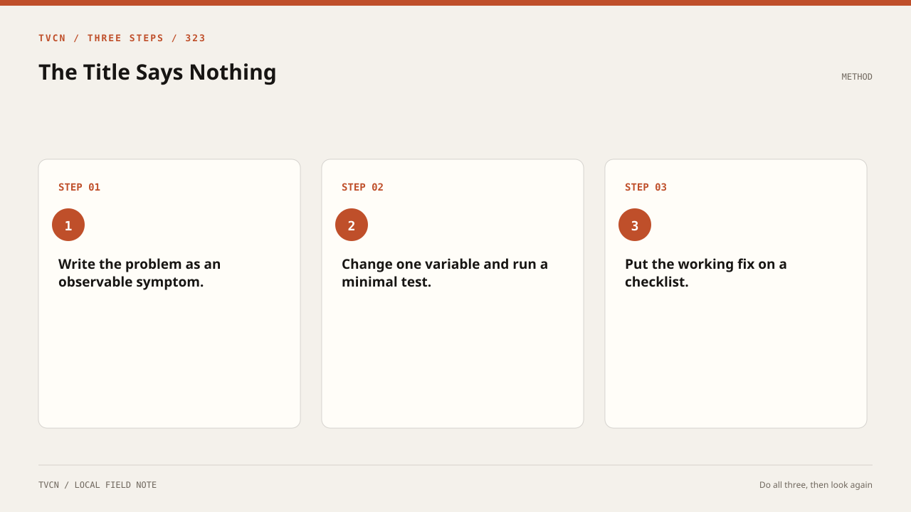

A title with no information: write “who hits what result.” More adjectives means fewer clicks.

<!-- DIAGRAM_START -->
<h2>Diagram</h2>
<figure>
  
  <figcaption>Watch “Write three titles using person plus action plus” and “Cut empty words such as “shocking,” “premium,” and”; judge whether the symptom can be restated as one observable sentence.</figcaption>
</figure>
<!-- DIAGRAM_END -->
<section><h2 id="section-1">On set</h2>
Write who meets what result. Fewer adjectives. The title and body must be the same story.
</section><section><h2 id="section-2">Do this</h2><ol><li>Write three titles using person plus action plus result or cost.</li><li>Cut empty words such as “shocking,” “premium,” and “must-see.”</li><li>Choose one that matches the body exactly; do not bait.</li></ol></section><section><h2 id="section-3">Avoid</h2>
Do not trade an exaggerated promise for clicks; when the body cannot cash it, the audience leaves.
</section><section><h2 id="section-4">Three causes</h2>
For “The Title Says Nothing”, check three directions first. Change one variable, record a 30-second comparison, and see which link the change follows.

<table class="data-table"><thead><tr><th>Cause</th><th>Signal on set</th><th>Five-minute test</th></tr></thead><tbody><tr><td>Abstract nouns only</td><td>“Growth”, “choice” and “goodbye” have no object, so nothing seems to happen</td><td>Replace the noun with a person and an action</td></tr><tr><td>No conflict</td><td>The title gives the conclusion and the piece has no question</td><td>Add a concrete obstacle or cost</td></tr><tr><td>Keyword stuffing</td><td>The title reads like a search box and never says whose story it is</td><td>Remove two keywords and keep one action</td></tr></tbody></table>
</section><section><h2 id="section-5">On-set diagnosis</h2><ol><li>Read the title to someone who has not seen the piece and ask what they think will happen.</li><li>If they can only repeat abstract words, the title is under-specified.</li><li>Compare title and first scene: does the promised action appear?</li></ol></section><section><h2 id="section-6">Fix</h2>
A good title is not a summary of theme; it is a person, an action and a cost. It should predict the first scene, not explain the film.
<ol><li>Write “who + wants what + what blocks it”, then cut to twelve words or fewer.</li><li>Put the most specific prop in the title: the cat, the old coat, the last delivery.</li><li>Keep one unknown: do not reveal the result, only the price.</li><li>If it sounds like a paper, rewrite it as something a character would say.</li></ol></section><section><h2 id="section-7">Failure cases</h2>
With “The Title Says Nothing”, these three moves make it worse. Pick one replacement action and do not change three variables at once.

<table class="data-table"><thead><tr><th>Failure</th><th>Why it gets worse</th><th>Replace with</th></tr></thead><tbody><tr><td>Clickbait</td><td>The piece cannot pay off the title and the audience leaves</td><td>Promise only an action the first scene can deliver</td></tr><tr><td>Restatement</td><td>Title and summary say the same thing</td><td>Title gives action; summary gives conditions</td></tr><tr><td>Keyword pile</td><td>It reads like a tag list</td><td>Keep at most one search phrase</td></tr></tbody></table>
</section><section><h2 id="section-8">Acceptance table</h2>
Acceptance is not “it feels better”; all four must be identifiable, playable and logged.

<table class="data-table"><thead><tr><th>Check</th><th>Pass line</th><th>Log</th></tr></thead><tbody><tr><td>Concrete subject</td><td>A person or object, not only an abstract noun</td><td>Circle the nouns</td></tr><tr><td>Action</td><td>The title answers what happens</td><td>Ask a stranger to retell it</td></tr><tr><td>Cost</td><td>The title implies what may be lost</td><td>Write one cost line</td></tr><tr><td>Payoff</td><td>The first scene contains the promised action</td><td>Compare with the body</td></tr></tbody></table>
</section><section><h2>Boundary</h2>
This page only covers “The Title Says Nothing”; it does not replace The Film Is Too Long, The Transition Is Jarring, 16mm: Cinema Left the Theater. When the problem belongs to one of those pages, use that page instead of adding more parameters here.
</section><section><h2>Alternative</h2>
If “Write three titles using person plus action plus result or cost” is not the main problem, start with “Cut empty words such as “shocking,” “premium,” and “must-see.””; only upgrade after both hold.
</section><section><h2>60-second test</h2>
Run one 60-second test against check 1: The title contains person plus action plus result or cost. If check 2 (Empty words such as “shocking,” “premium,” and “must-see” are gone) does not change, do not add gear or budget.
</section>
<h2>Check</h2><ul><li>The title contains person plus action plus result or cost.</li><li>Empty words such as “shocking,” “premium,” and “must-see” are gone.</li><li>The title matches the body exactly; there is no bait.</li></ul>

<!-- SOURCES_START -->
## Experience note

Experience note:This page draws on 5 projects with one lead and a two-to-three-person crew, a fixed budget and schedule; it covers the decision order for “The Title Says Nothing”, not an external laboratory test, multi-camera, union crews, stunts or high-risk sets.
<!-- SOURCES_END -->

