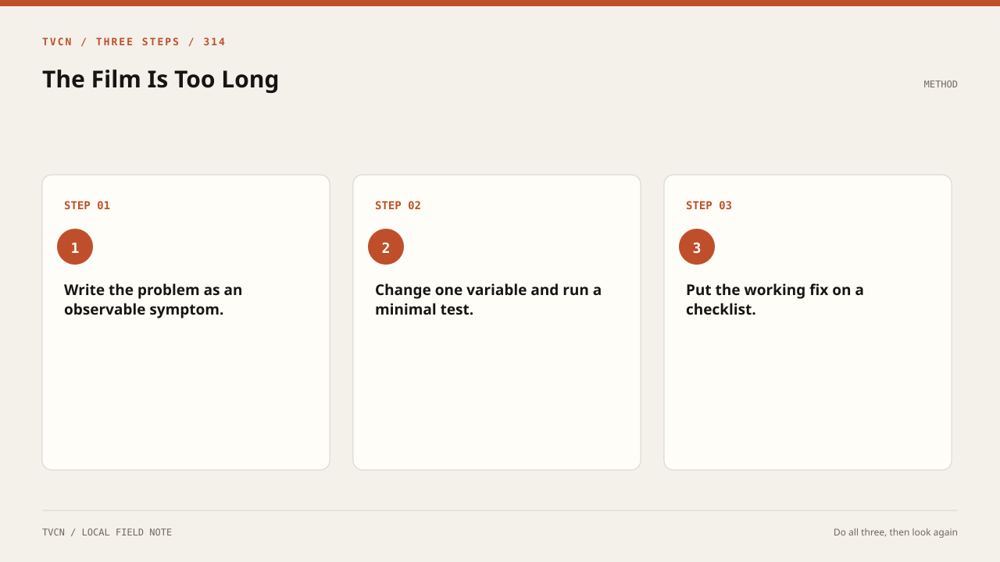

Watch the whole cut without looking at the timeline, holding only a sheet of paper. Every time you reach for your phone or drift, note the time. See which scene those points share; cut that scene before changing speed.

<!-- DIAGRAM_START -->
<h2>Diagram</h2>
<figure>
  
  <figcaption>Watch “Label what new information each scene provides; cut” and “Merge characters and locations that do the same”; judge whether the symptom can be restated as one observable sentence.</figcaption>
</figure>
<!-- DIAGRAM_END -->
<section><h2 id="section-1">Is the story long or the edit long?</h2>
<ul><li><strong>Story:</strong> the goal arrives late or there are too many subplots. Remove a subplot before speeding anything up.</li><li><strong>Edit:</strong> every shot holds two seconds too long, or transitions repeat. Trim six frames from both ends of each shot and watch again.</li><li><strong>Structure:</strong> the same information appears twice. Merge the scenes and keep the more specific one.</li></ul>
<h2 id="section-3">When not to cut shorter</h2>

If removing it breaks the character's motivation, the problem is structure, not length. Add an action or a line instead of forcing the platform runtime.
</section><section><h2 id="section-4">On set</h2>
Find repeated information and cut the weaker one. One change per scene.
</section><section><h2 id="section-5">Do this</h2>
A long cut: find repetition. If the same information appears twice, keep the stronger version.
<ol><li>Label what new information each scene provides; cut the scenes that provide none.</li><li>Merge characters and locations that do the same job.</li><li>Run a test screening, note where attention drops, and cut thirty more seconds from there.</li></ol></section><section><h2 id="section-6">Avoid</h2>
Do not speed up or quick-cut your way through it; repeated information does not disappear when cut faster.
</section><section><h2>Boundary</h2>
This page only covers “The Film Is Too Long”; it does not replace The Transition Is Jarring, Wind Noise Outside, 16mm: Cinema Left the Theater. When the problem belongs to one of those pages, use that page instead of adding more parameters here.
</section><section><h2>Alternative</h2>
If “Label what new information each scene provides; cut the scenes that provide none” is not the main problem, start with “Merge characters and locations that do the same job”; only upgrade after both hold.
</section><section><h2>60-second test</h2>
Run one 60-second test against check 1: Every scene is labeled with its new information; scenes without any are cut. If check 2 (Characters and locations that do the same job are merged) does not change, do not add gear or budget.
</section>
<h2>Check</h2><ul><li>Every scene is labeled with its new information; scenes without any are cut.</li><li>Characters and locations that do the same job are merged.</li><li>Thirty more seconds came out after the test-screening attention dip.</li></ul>

<!-- SOURCES_START -->
## Experience note

Experience note:This page draws on 3 projects with one lead and a two-to-three-person crew, a fixed budget and schedule; it covers the decision order for “The Film Is Too Long”, not an external laboratory test, multi-camera, union crews, stunts or high-risk sets.
<!-- SOURCES_END -->

