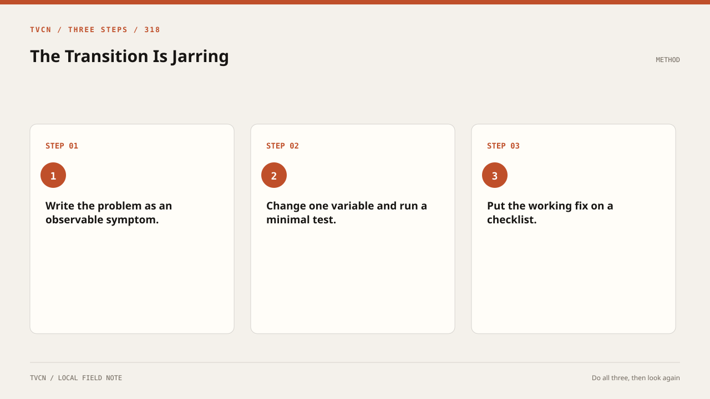

A hard transition: find an action, sound, or shape to bridge it. White flashes and whip pans only work once.

<!-- DIAGRAM_START -->
<h2>Diagram</h2>
<figure>
  
  <figcaption>Watch “Leave an action unfinished at the end of” and “Bring sound in early or let it linger”; judge whether the symptom can be restated as one observable sentence.</figcaption>
</figure>
<!-- DIAGRAM_END -->
<section><h2 id="section-1">On set</h2>
Find an action, sound, or shape match. A white flash works once.
</section><section><h2 id="section-2">Do this</h2><ol><li>Leave an action unfinished at the end of one shot and pick it up in the next.</li><li>Bring sound in early or let it linger to connect the two spaces.</li><li>Match a shape, color, or composition across the cut.</li></ol></section><section><h2 id="section-3">Avoid</h2>
Do not use white flashes or spin wipes as universal glue; repeated, they pull the audience out.
</section><section><h2 id="section-4">Three causes</h2>
For “The Transition Is Jarring”, check three directions first. Change one variable, record a 30-second comparison, and see which link the change follows.

<table class="data-table"><thead><tr><th>Cause</th><th>Signal on set</th><th>Five-minute test</th></tr></thead><tbody><tr><td>Hard cuts only</td><td>Every transition is a cut with no time or space bridge</td><td>Add an action or sound bridge</td></tr><tr><td>No shared information</td><td>Scene A ends on one idea and scene B starts somewhere unrelated</td><td>Give the end and start a shared object</td></tr><tr><td>Music cuts hard</td><td>The picture changes but the score stays in the old section</td><td>Resolve or carry the music</td></tr></tbody></table>
</section><section><h2 id="section-5">On-set diagnosis</h2><ol><li>Play three seconds either side of each transition and list what the audience knows and does not know.</li><li>Check whether the cut shares an action, object or sound.</li><li>Turn off music and see whether the picture still transitions.</li></ol></section><section><h2 id="section-6">Fix</h2>
A transition does not hide time; it explains time. Find a shared anchor: action, object, sound or gaze.
<ol><li>Match action: a door closes in one scene and opens in the next.</li><li>Bridge with sound: the room tone of the previous scene continues into the next.</li><li>Match gaze: a character looks at an object and the next shot shows it.</li><li>Keep two seconds of tail and head; do not add an effect to every cut.</li></ol></section><section><h2 id="section-7">Failure cases</h2>
With “The Transition Is Jarring”, these three moves make it worse. Pick one replacement action and do not change three variables at once.

<table class="data-table"><thead><tr><th>Failure</th><th>Why it gets worse</th><th>Replace with</th></tr></thead><tbody><tr><td>Overuse dissolves</td><td>Dissolves slow time and fight the scene’s pace</td><td>Use them only for time jumps</td></tr><tr><td>Add a whoosh</td><td>The effect hides the logic; the audience still does not know where they are</td><td>Build the spatial/time anchor first</td></tr><tr><td>Fade every scene</td><td>The film feels like a slide deck</td><td>Keep hard cuts and fix only information gaps</td></tr></tbody></table>
</section><section><h2 id="section-8">Acceptance table</h2>
Acceptance is not “it feels better”; all four must be identifiable, playable and logged.

<table class="data-table"><thead><tr><th>Check</th><th>Pass line</th><th>Log</th></tr></thead><tbody><tr><td>Anchor</td><td>Every transition has a shared action, object or sound</td><td>Mark scene by scene</td></tr><tr><td>Time</td><td>The audience knows how much time passed</td><td>Ask a fresh viewer</td></tr><tr><td>Space</td><td>The audience knows where they are</td><td>Check the establishing shot</td></tr><tr><td>Handles</td><td>Two clean seconds around the transition</td><td>Inspect tail/head</td></tr></tbody></table>
</section><section><h2>Boundary</h2>
It does not guarantee a story. The template only orders structure; the person, obstacle and cost still need writing.
</section><section><h2>Alternative</h2>
If “Leave an action unfinished at the end of” is not the main problem, start with the basic move behind “Bring sound in early or let it linger”. Upgrade only after both hold.
</section><section><h2>60-second test</h2>
Run a 60-second test with the gear you own, focused on “Leave an action unfinished at the end of”, and record one number. If the number does not change, do not add budget.
</section><section><h2>When not to use</h2>
Do not use the template when “Leave an action unfinished at the end of” is still unclear or “Bring sound in early or let it linger” is only filler. Go back to the person and the problem.
</section><section><h2>Three failures</h2><ul><li>Every beat exists, but no one makes a decision.</li><li>The middle changes location, not information.</li><li>The ending is narrated, with no visible change.</li></ul></section>
<h2>Check</h2><ul><li>An unfinished action ends one shot and continues in the next.</li><li>Sound arrives early or lingers to connect the spaces.</li><li>The cut uses a shape, color, or composition match, not a white flash.</li></ul>
