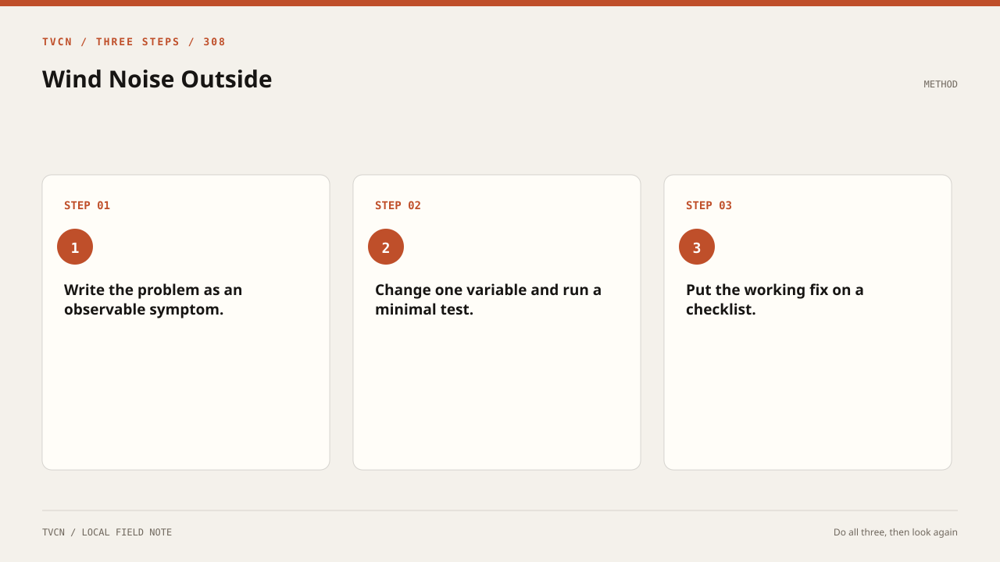

Use a windshield and find shelter; post cannot recover words eaten by wind.

<!-- DIAGRAM_START -->
<h2>Diagram</h2>
<figure>
  
  <figcaption>Do the three steps in order, then look again at the image or file.</figcaption>
</figure>
<!-- DIAGRAM_END -->
<h2>On set</h2>

Use a wind screen, find shelter, and block the wind with your body. Post cannot recover words the wind ate.

<h2>Do this</h2>

Outdoor wind: put a windshield on the mic first, then find shelter. Post noise reduction cannot recover words the wind ate.
<ol><li>Fit a furry windshield or cage on the shotgun; add a wind cover to lavs.</li><li>Use your body, a backpack, or a wall as a barrier, and move the mic closer to the mouth.</li><li>Record a sheltered reference track and use only light noise reduction later.</li></ol>
<h2>Avoid</h2>

Do not tell yourself post will fix it; wind takes consonants first.

<h2>Check</h2>
<ul><li>The shotgun has a windshield and the lav has a furry cover.</li><li>A body, backpack, or wall blocks the wind at the shooting spot.</li><li>Consonants survive the wind and post uses only light noise reduction.</li></ul>
