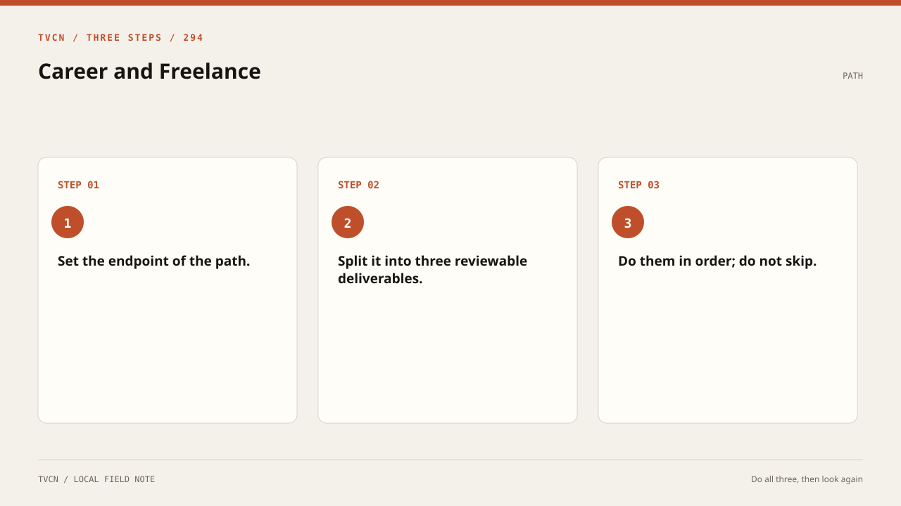

Career starts with survival, then style; quoting, contracts, portfolio, and repeat clients beat one more plugin.

<!-- DIAGRAM_START -->
<h2>Diagram</h2>
<figure>
  
  <figcaption>Do the three steps in order, then look again at the image or file.</figcaption>
</figure>
<!-- DIAGRAM_END -->
<h2>On set</h2>

Make three capability films, then price by days plus gear, post, and revisions. Put the revision count in the contract.

<h2>Do this</h2>

A career path survives first, then talks style; pricing, contracts, portfolio, and repeat work matter more than one more plugin.
<ol><li>Make three capability films, each proving one deliverable skill.</li><li>Price by days times day rate, plus gear, post, and revisions.</li><li>Contracts state revision rounds; the portfolio holds only projects whose process you can explain.</li></ol>
<h2>Avoid</h2>

Do not substitute volume for capability; three explainable films beat thirty reels.

<h2>Check</h2>
<ul><li>Three capability films each prove a different deliverable skill.</li><li>Quotes break into days, day rate, gear, post, and revisions.</li><li>Contracts state revision rounds and portfolio projects have explainable processes.</li></ul>
