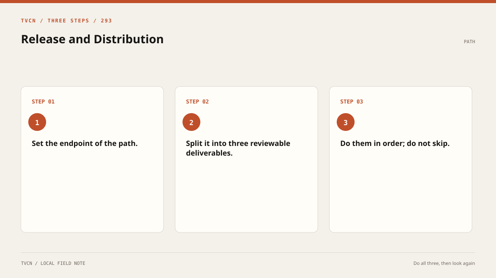

<!-- DIAGRAM_START -->
<h2>Diagram</h2>
<figure>
  
  <figcaption>Do the three steps in order, then look again at the image or file.</figcaption>
</figure>
<!-- DIAGRAM_END -->
<h2>Before you start</h2>
Confirm a locked master, one primary and two distribution platforms, the platform specs for frame, runtime, captions, and cover, and time to check data forty-eight hours after launch.
<h2>How the path runs</h2>
Lock the master, derive platform cuts, then write titles and covers. Do not design a cover before the master is locked.
<ol><li><strong>Step 1: Master</strong>: The master never changes; every platform cut derives from it. Name it title_master_date and keep a read-only copy. The master holds the fullest captions and highest quality; platform cuts only reframe, compress, and adjust captions. <em>Output: One read-only master and a master spec sheet.</em></li><li><strong>Step 2: Platform specs</strong>: Do not rely on memory; check the platform help page before publishing. Vertical is not a center crop: subject, captions, and safe area are redrawn. Give each platform a column and tick it off. <em>Output: A platform spec table.</em></li><li><strong>Step 3: Title and cover</strong>: The title promises only what the film delivers: who, what happens, what result. The cover shows an action, not just a pretty face. Title and cover answer the same question; do not pair emotion with information. <em>Output: Five titles, three covers, one reason for the choice.</em></li><li><strong>Step 4: Captions and access</strong>: Place platform captions inside the safe area, off faces and hands. Open captions are burned in for silent viewing; SDH labels sound events, not just dialogue. Keep Chinese under sixteen characters and English under forty-two per line. <em>Output: Three caption files and a caption check sheet.</em></li><li><strong>Step 5: Upload and search</strong>: Search is not keyword stuffing; it is making the problem obvious. Put the topic in the title, the result and audience in the first two description lines, and format, tool, and setting in tags. After upload, search one keyword yourself. <em>Output: Title, description, tags.</em></li><li><strong>Step 6: Launch</strong>: Post one tease before launch; do not give the film away. Watch comments and completion for the first two hours and log specific questions, not just “thanks.” Do not change title, cover, and description on launch day; you will not know which variable worked. <em>Output: A launch checklist, one tease, and a comment-question log.</em></li><li><strong>Step 7: Forty-eight-hour review</strong>: Within forty-eight hours log four numbers: completion, three-second retention, traffic source, and repeated comment questions. Do not judge the film from one launch; find one change for next time, such as “open on a person's action instead of scenery.” <em>Output: A review sheet and one next change.</em></li></ol><h2>Three exercises</h2><ol><li><strong>Exercise 1: Five titles, three covers</strong>: Write five titles and make three covers for one film; ask someone to choose and explain. <em>Output: Five titles, three covers, one reason.</em></li><li><strong>Exercise 2: One platform cut</strong>: Make one vertical cut from the master; redraw subject, captions, and safe area instead of center-cropping. <em>Output: One platform cut.</em></li><li><strong>Exercise 3: Forty-eight-hour review</strong>: Forty-eight hours after release, log four numbers and write one concrete change. <em>Output: A review sheet.</em></li></ol><h2>Deliverables</h2><ul><li>Read-only master and spec sheet</li><li>Platform spec table</li><li>Five titles and three covers</li><li>Three caption files</li><li>Title, description, tags</li><li>Launch checklist and tease</li><li>Forty-eight-hour review sheet</li></ul><h2>Where it goes wrong</h2><ul><li>Posting one master everywhere: platforms are not pipes; viewing differs.</li><li>Making the cover on launch day: a rushed cover gets no clicks.</li><li>Changing title, cover, and description on the same day: you cannot tell what worked.</li></ul><h2>Next step</h2>
Next, take path-career to turn release results into a portfolio and quotes, or return to path-post to improve delivery quality.

<h2>Check</h2><ul><li>One master; platform cuts trace back.</li><li>Each platform has its own spec.</li><li>The title promises only what the film delivers.</li><li>Captions clear the subject; SDH includes sound events.</li><li>One keyword search finds it.</li><li>Only one variable changes on launch day.</li><li>Review has four numbers and one concrete change.</li></ul>
