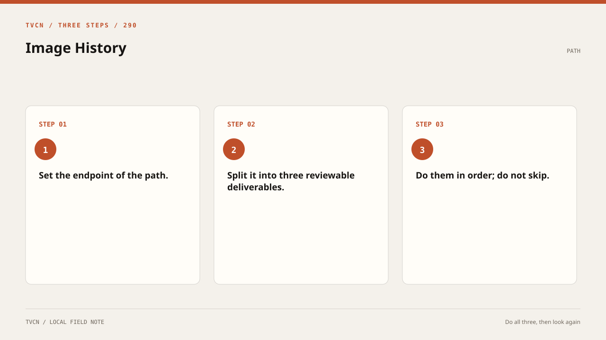

Image history is not a timeline; it helps judge which old problem a new tool actually solves.

<!-- DIAGRAM_START -->
<h2>Diagram</h2>
<figure>
  
  <figcaption>Do the three steps in order, then look again at the image or file.</figcaption>
</figure>
<!-- DIAGRAM_END -->
<h2>On set</h2>

Pick a technology today and trace the old problem it solved: sync sound, shallow depth, reproducibility. Then build the timeline.

<h2>Do this</h2>

Film history is not a timeline; it helps judge which old problem a new tool actually solves.
<ol><li>Pick a current technology, such as autofocus or HDR.</li><li>Trace its old problem: sync sound, shallow depth, reproducibility.</li><li>Build a timeline marking where the problem was first solved.</li></ol>
<h2>Avoid</h2>

Do not memorize film history as dates; without the old problem, a new tool is only a spec.

<h2>Check</h2>
<ul><li>The chosen technology maps to a specific old problem.</li><li>The timeline marks the work or year the problem was first solved.</li><li>One problem the technology still leaves unsolved is named.</li></ul>
