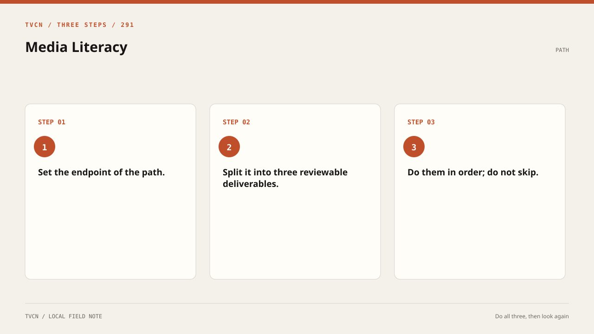

Media literacy is not "don't believe"; it is naming what a video wants you to believe.

<!-- DIAGRAM_START -->
<h2>Diagram</h2>
<figure>
  
  <figcaption>Do the three steps in order, then look again at the image or file.</figcaption>
</figure>
<!-- DIAGRAM_END -->
<h2>On set</h2>

For each video write three lines: what it wants me to believe, what it cut, who benefits. Do five a week.

<h2>Do this</h2>

Media literacy is not “do not believe”; it is naming what each video wants you to believe.
<ol><li>For each video write three lines: what it wants me to believe.</li><li>What it cut or did not show you.</li><li>Who benefits; do five a week and compare sources.</li></ol>
<h2>Avoid</h2>

Do not end with “it's fake”; if you cannot name what was cut, you did not read it.

<h2>Check</h2>
<ul><li>Each video gets three lines: claim, omission, beneficiary.</li><li>Five are completed in a week from different sources.</li><li>Two outlets' differing omissions on one event are identified.</li></ul>
