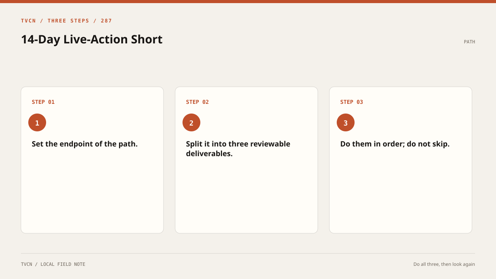

A fourteen-day short is not a stretched seven-day film; it gives prep, shoot, and post one round of correction each.

<!-- DIAGRAM_START -->
<h2>Diagram</h2>
<figure>
  
  <figcaption>Do the three steps in order, then look again at the image or file.</figcaption>
</figure>
<!-- DIAGRAM_END -->
<h2>On set</h2>

Split fourteen days into 3, 6, and 5: three for writing, casting, and location; six to shoot; five to edit, grade, and mix. Keep half of day seven for backup and pickups.

<h2>Do this</h2>

A fourteen-day live-action short is not a stretched seven days; it gives preproduction, shoot, and post one rework pass each.
<ol><li>Split 14 days into 3, 6, 5: three to write, cast, and find locations; six to shoot; five to cut, grade, and mix.</li><li>Keep half of day seven for backup and pickups.</li><li>End each phase with a viewable file, not a verbal status.</li></ol>
<h2>Avoid</h2>

Do not book fourteen days as double the work of seven; the extra days are for rework.

<h2>Check</h2>
<ul><li>Fourteen days split into 3, 6, 5 with matching dates.</li><li>Day seven holds a half-day for backup and pickups.</li><li>Each phase ends with a playable file as its deliverable.</li></ul>
