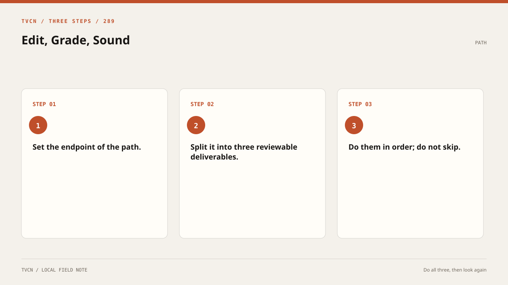

Post moves through media, structure, sound, color, and delivery; do not pass a gate that is not locked.

<!-- DIAGRAM_START -->
<h2>Diagram</h2>
<figure>
  
  <figcaption>Do the three steps in order, then look again at the image or file.</figcaption>
</figure>
<!-- DIAGRAM_END -->
<h2>On set</h2>

Five gates: media, rough cut, fine cut, sound, and grade plus delivery. Leave one review at each gate.

<h2>Do this</h2>

Post follows five gates: media, structure, sound, color, delivery; do not pass a gate that is not locked.
<ol><li>Gate one: ingest, backup, proxies.</li><li>Gates two and three: rough cut for structure, fine cut for rhythm.</li><li>Gates four and five: sound, color, delivery, each with a review pass.</li></ol>
<h2>Avoid</h2>

Do not grade before the rough cut locks; a structure change wastes the color.

<h2>Check</h2>
<ul><li>Five gates each have written pass conditions in the project doc.</li><li>Fine cut and sound start only after rough-cut structure locks.</li><li>Each gate has a review note and issues do not carry forward.</li></ul>
