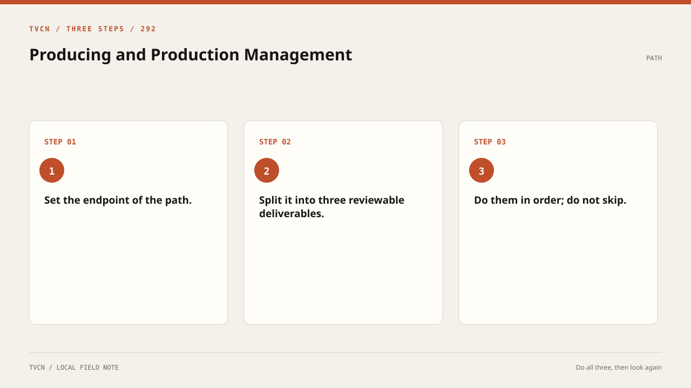

Bring a real project with cast, location, gear, budget, and a delivery date. If none, use a film you will actually shoot in the next three months, not a hypothetical.

<!-- DIAGRAM_START -->
<h2>Diagram</h2>
<figure>
  
  <figcaption>Watch “Step 1: Scope : Three columns: deliverables, non-deliverables,” and “Step 2: Budget : Each block has a”; judge whether the symptom can be restated as one observable sentence.</figcaption>
</figure>
<!-- DIAGRAM_END -->
<section><h2 id="section-1">Before you start</h2></section><section><h2 id="section-2">How the path runs</h2>
Producing works backward: define the stop line, build the schedule backward, then fill the budget. Do not start with a gear list and discover the money is short.
<ol><li><strong>Step 1: Scope</strong>: Three columns: deliverables, non-deliverables, revisions. Put “one more cut” and “one more subtitle language” under out of scope or a separate quote. Scope is a contract exhibit, not a wish list. <em>Output: A one-page scope sheet.</em></li><li><strong>Step 2: Budget</strong>: Each block has a cap and cannot borrow from another. Contingency sits before the shoot, not at the end. The budget must answer “if one day disappears, which block is cut?” If not, it is numbers, not a decision tool. Rights, insurance, and transport get their own rows. <em>Output: A five-block budget and one “cut first” answer.</em></li><li><strong>Step 3: Schedule</strong>: Lock delivery, then reserve thirty percent for post, forty for shoot, thirty for prep. Shoot the same location on the same day; shoot difficult light and children first. Leave a pickup window each day. Put a latest-decision date for cast, location, and gear. <em>Output: A reverse schedule and three latest-decision dates.</em></li><li><strong>Step 4: People</strong>: Director, camera, sound, light, producing, post: who does it, who backs up, who to call. Do not write “we'll figure it out.” A key role without a backup is project risk. <em>Output: A crew table: role/primary/backup/contact.</em></li><li><strong>Step 5: Permits and risk</strong>: Ask for permits for public space, shops, transit, and parks; confirm insurance covers gear and third parties. Risk sheet: who can get hurt, what can fall, who owns it, nearest hospital. The whole crew reads it; producing does not sign alone. <em>Output: Permit list, risk sheet, nearest hospital.</em></li><li><strong>Step 6: Shoot day</strong>: Send the call sheet a day early with time, address, contact, parking, meals, hospital, load-out. Ten minutes before roll, the crew names the three must-get shots. Before wrap, confirm backup, log, prop return, and tomorrow's call sheet. <em>Output: Daily call sheet, three must-get shots, wrap checklist.</em></li><li><strong>Step 7: Delivery and close</strong>: Lock one master with resolution, bitrate, captions, loudness, and filename. Archive releases by project for at least three years. Close with a review: where the budget overran, where the schedule failed, what changes next time. <em>Output: Master, delivery sheet, rights archive, review.</em></li></ol></section><section><h2 id="section-3">Three exercises</h2><ol><li><strong>Exercise 1: One-page scope</strong>: Write deliverables/non-deliverables/revisions; show it to someone outside the project. <em>Output: A one-page scope.</em></li><li><strong>Exercise 2: Reverse schedule</strong>: Build fourteen days backward from delivery and mark three latest-decision dates. <em>Output: A reverse schedule.</em></li><li><strong>Exercise 3: Risk sheet</strong>: List weather, gear, people, and rights risks with one owner each. <em>Output: A four-row risk sheet.</em></li></ol></section><section><h2 id="section-4">Deliverables</h2><ul><li>One-page scope</li><li>Five-block budget</li><li>Reverse schedule and three latest-decision dates</li><li>Crew table with backups</li><li>Permit list and risk sheet</li><li>Daily call sheet and wrap checklist</li><li>Master, delivery sheet, rights archive, review</li></ul></section><section><h2 id="section-5">Where it goes wrong</h2><ul><li>Starting with a gear list: gear is a result, not a starting point; lock scope and delivery first.</li><li>Expanding scope with “we'll do it first”: if money and time do not change, the project ends badly.</li><li>A risk sheet only producing reads: if the crew does not read it, it does not exist.</li></ul></section><section><h2 id="section-6">Next step</h2>
Next, take path-distribution to release, or return to path-live-film to tighten shoot execution.
</section>
<h2>Check</h2><ul><li>Scope states exclusions and revision count.</li><li>Contingency is at least ten percent; every block is capped.</li><li>Every key role has a backup and a contact.</li><li>Every shoot day has a Plan B.</li><li>Permits, insurance, noise, load-out, and hospital sit on one sheet.</li><li>One master, archived rights, and one concrete review change.</li></ul>

<!-- DEEP_DIVE_START -->
## Deep dive

<strong>About 7 minutes.</strong> Producing is not managing people. It is keeping money, time, crew, and permission on the same sheet.

### Four budget blocks

Prep, shoot, post, contingency. Each block has a cap; do not borrow across them. Contingency is at least ten percent, held before the shoot, not at the end. Talent, location, music, and font licenses get their own line.

The budget must answer “if we lose a day, which block gets cut?” If it cannot, it is a list of numbers, not a decision tool.

### Schedule and call sheet

Break the script into strips: scene, pages, cast, props, camera. Shoot the same location on the same day; schedule the difficult light and children first. Leave one pickup window each day; do not fill every hour.

The call sheet states time, address, contact, parking, meals, nearest hospital. Send it the day before, not the morning of. Everyone should know when to arrive and what they are doing.

### Risk, permits, delivery

Before rolling, fill one risk page: who can get hurt, what can fall, who is responsible, nearest hospital. Read it to the crew. For public space, shops, subway, parks, ask permission first; do not shoot and apologize later.

Before delivery, define one master: resolution, bitrate, subtitles, loudness, naming. Keep three backups, one off-site. Producing does not end at wrap; it ends when the next person can find the files and the rights.

### Five-minute drill: one-page production sheet

Take a small project and write one page: four budget blocks, two shoot days, five scenes, three names, three permits, one delivery spec. Every row gets an owner and a date.

Show it to someone outside the project and ask, “if it rains tomorrow, which row changes first?” If they can answer, the sheet works. If not, add priorities.

### Ten producing checks
<ul><li>Budget in four blocks</li><li>Contingency at least ten percent</li><li>Licenses on their own line</li><li>Budget answers what gets cut first</li><li>Script broken into strips</li><li>Same location, same day</li><li>Pickup window each day</li><li>Call sheet sent the day before</li><li>Risk page read to crew</li><li>One master and three backups</li></ul>
Producing is not making everyone listen. It is making everyone know, on the same day, where the money is, where the time is, and who does the next thing.

<!-- DEEP_DIVE_END -->

<!-- SOURCES_START -->
## References and further reading

- [S22] [National People's Congress: Civil Code](http://www.npc.gov.cn/npc/c2/c30834/202006/t20200602_306457.html) — Accessed 2026-11-26. Used to check the terminology and public context in the opening paragraph (“Producing is not ordering lunch; it locks scope, money, peop”) against Statutory text on portrait rights, privacy, contracts and location rights; not a substitute for an on-set test.
- [S38] [State Taxation Administration: Official site](https://www.chinatax.gov.cn/) — Accessed 2026-11-26. Used to check the terminology and public context in the opening paragraph (“Producing is not ordering lunch; it locks scope, money, peop”) against Official entry for VAT, cross-border services and withholding; not a substitute for an on-set test.
<!-- SOURCES_END -->

