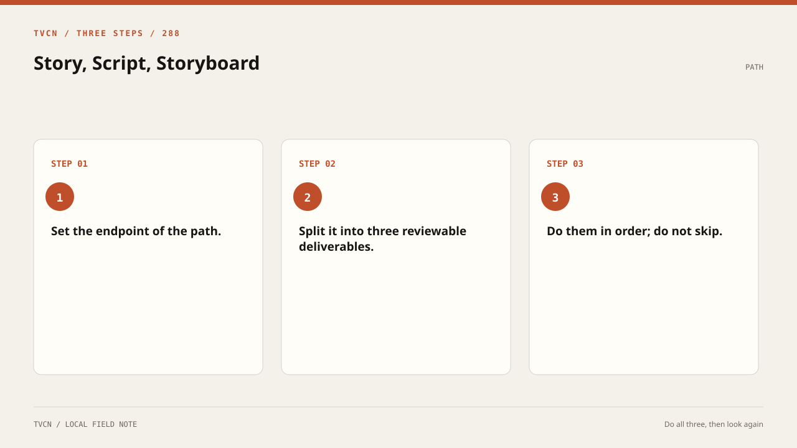

<!-- DIAGRAM_START -->
<h2>Diagram</h2>
<figure>
  
  <figcaption>Do the three steps in order, then look again at the image or file.</figcaption>
</figure>
<!-- DIAGRAM_END -->
<h2>Before you start</h2>
Bring three things: a real location you can shoot, a person you can cast, and a real action you have seen. Do not start from a theme; start from what someone wants.
<h2>How the path runs</h2>
Six steps only: one line, want and stakes, three scenes, eight to twelve shots, table read, rewrite. Every step lands on paper.
<ol><li><strong>One line: who wants what</strong>: Each line under forty Chinese characters with one concrete action and one obstacle. Not “a man is lonely,” but “a night guard wants to be seen, but the camera only catches him dozing.” Circle the one that gives you three shots immediately. <em>Output: One logline and three shootable images.</em></li><li><strong>Want and stakes: what losing costs</strong>: The want must be concrete: a job, a room, a person turning around. The loss must be visible: money, housing, a relationship, dignity. The price must be an action: lie, borrow, quit, walk ten kilometers. The columns cannot substitute for each other. <em>Output: A three-column character sheet.</em></li><li><strong>Three scenes: one change each</strong>: Scene one sets the want, scene two raises the same obstacle, scene three changes the approach. Each scene must end different from it began: relationship, information, or decision. Cut scenes that only explain backstory. <em>Output: Three scenes, one page each maximum.</em></li><li><strong>Eight to twelve shots: break the scene</strong>: Write what the audience must see, then choose framing. One main action per shot; every scene needs a wide, a close, and an insert. The sheet lists shot number, framing, action, line, and duration. <em>Output: An eight-to-twelve-shot sheet and one camera plan per scene.</em></li><li><strong>Table read: only three questions</strong>: Do not explain or defend during the read. Ask readers to mark three places: unclear, boring, unbelievable. After the read, ask only those three questions, never “is it good?” <em>Output: Three marks and a one-page rewrite list.</em></li><li><strong>Rewrite: cut explanation, add action</strong>: Delete “because… therefore…” sentences and replace them with what someone does. Replace “he is angry” with “he puts the cup back; the base clicks.” Read again and confirm every scene still changes. <em>Output: A rewrite with three cuts marked.</em></li></ol><h2>Three exercises</h2><ol><li><strong>Exercise 1: Ten openings</strong>: Write ten first lines for the same story; every one is an action already happening. <em>Output: Choose one opening.</em></li><li><strong>Exercise 2: Three scenes on one page</strong>: One line each for want, obstacle, turn, and end state. <em>Output: A shootable three-scene sheet.</em></li><li><strong>Exercise 3: Rewrite three places</strong>: Have two people read and change only their first three marks. <em>Output: A v2 draft.</em></li></ol><h2>Deliverables</h2><ul><li>One logline</li><li>A want/loss/price sheet</li><li>Three scenes, one page each</li><li>An eight-to-twelve-shot sheet</li><li>One table-read record</li><li>One rewrite</li></ul><h2>Where it goes wrong</h2><ul><li>Starting from a theme: “I want to say loneliness” produces explanation; “what does he want” produces action.</li><li>Two changes in one scene: the audience cannot absorb them and the edit cannot connect them.</li><li>Boarding as art: the shot sheet is an execution file; framing, action, and duration matter more than drawing.</li></ul><h2>Next step</h2>
Next, take path-live-film to turn the script into a fourteen-day shoot, or path-post to make the three scenes work in the edit.

<h2>Check</h2><ul><li>The line is repeatable and ends on an action.</li><li>Every scene changes; removing one breaks the story.</li><li>One main action per shot.</li><li>The table read found at least three places needing explanation.</li><li>The rewrite has less explanation and more action.</li><li>The eight to twelve shots can be shot with what you have.</li></ul>
