<!-- DIAGRAM_START -->
## Diagram

<figure>
  
  <figcaption>One job per day: idea, board, pack, shoot, cover, cut, ship. Day seven must deliver.</figcaption>
</figure>
<!-- DIAGRAM_END -->

## What this path solves

Most first-time filmmakers get stuck thinking instead of shooting. This path does one thing: help you finish a watchable 60–90 second short in seven days, before you try to learn everything.

## The seven days

### Day 1: Find the line

Write one logline: who wants what, and what blocks them. One sentence, no more than 25 words.

### Day 2: Build eight shots

Do not write a literary script. Make an eight-panel shot sheet: framing, image, action, line, duration.

### Day 3: Prepare the minimum kit

A phone, something to hold it steady, and window light are enough. Do not buy gear yet.

### Days 4–5: Shoot

Get three takes per shot: a safe one, an adjusted one, and a risky one. Keep a shot log.

### Day 6: Rough cut

Cut for comprehension first. No transitions, no effects. Make the sound intelligible.

### Day 7: Publish and review

Export 1080p. Write three notes: where you got stuck, what to remove next time, what to keep.

## Three checks

- A stranger can say what the film is about after one viewing.
- The sound is clear, with no sudden peaks.
- No shot runs longer than three seconds without new information.

## Deliverables

One 60–90 second MP4, one eight-panel shot sheet, and three review notes.
