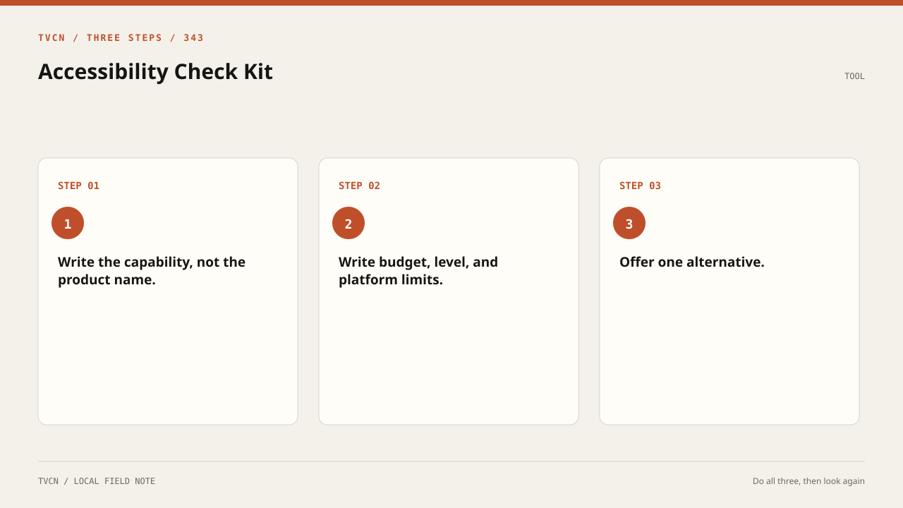

Captions, contrast, audio description and a flash check. Contrast and description are the ones most often skipped, and they decide whether low-vision viewers can follow.

<!-- DIAGRAM_START -->
<h2>Diagram</h2>
<figure>
  
  <figcaption>Watch “Minimum: an accurate caption file, readable caption styling,” and “Working: SDH captions (sound effects and speakers), an”; judge whether the symptom can be restated as one observable sentence.</figcaption>
</figure>
<!-- DIAGRAM_END -->
<section><h2 id="section-1">Four things first</h2>

<ul><li><strong>Minimum:</strong> an accurate caption file, readable caption styling, text for essential information.</li><li><strong>Working:</strong> SDH captions (sound effects and speakers), an audio-description script, contrast checks, keyboard-operable pages.</li><li><strong>Insured:</strong> multilingual captions, described audio mix, flash testing, tests with real users.</li></ul>
<h2 id="section-2">Captions are not just dialogue</h2>

Keep each line under roughly 16–18 Chinese characters, one or two lines. Mark speakers and key sounds. Keep captions inside the safe area, not on the bottom edge. Split fast speech instead of shrinking type.

<h2 id="section-3">Three checks</h2>
<ol><li>Watch muted: you still know who speaks, what happens and which sounds matter.</li><li>Shrink the frame to phone size: captions remain readable and contrast with the background.</li><li>Tab through the page: focus is visible and every link and button is reachable.</li></ol>
<h2 id="section-4">Do not fake accessibility</h2>

Unedited auto-captions, description that only narrates the image, and contrast judged by eye do not count. Accessibility is a delivery spec, not a favor.
</section><section><h2 id="section-5">On set</h2>
Subtitles, contrast, audio description, loudness, and flicker. Check each before delivery.
</section><section><h2 id="section-6">Avoid</h2>
Do not check captions only; failed contrast and flashing make the picture unwatchable.
</section><aside class="regional-note">
<strong>Regional note for US / UK / EU readers</strong>

This English page keeps mainland-China examples where they are part of the method. Read platform names as examples, not as the only market: Douyin ↔ TikTok/Reels, Bilibili ↔ YouTube, Xiaohongshu ↔ Instagram/Pinterest; RMB figures are not converted here. Contracts, tax, insurance and consent rules differ by market; use the local currency and local counsel before signing or invoicing.
</aside>
<h2>Check</h2><ul><li>Captions name speakers and key sounds at a compliant rate.</li><li>Text contrast, audio description, and loudness all pass.</li><li>Flashing is compliant and all five items are ticked before delivery.</li></ul>
