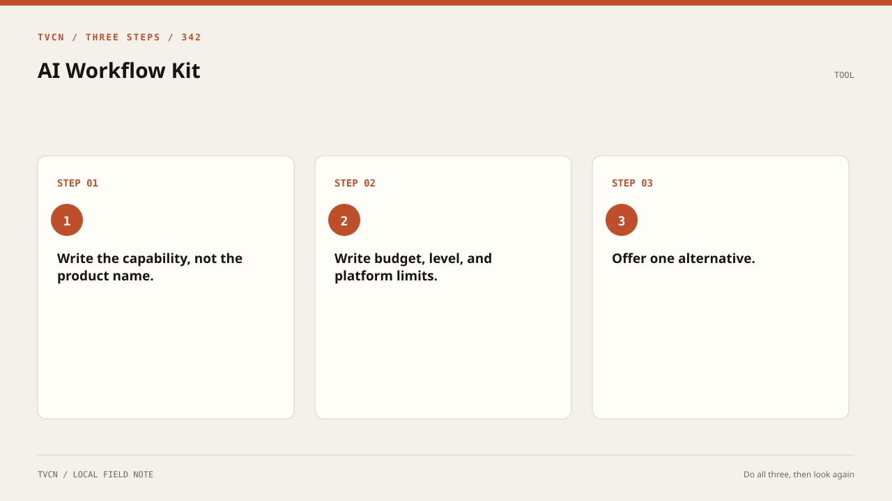

An AI workflow is not “one prompt and a finished film.” Lock the script, character bible, shot list, rights scope and delivery specs before deciding which shots to generate.

<!-- DIAGRAM_START -->
<h2>Diagram</h2>
<figure>
  
  <figcaption>Watch “Minimum: one usable generator, a set of character” and “Working: character sheet, shot-prompt template, generated-asset IDs, compositing”; judge whether the symptom can be restated as one observable sentence.</figcaption>
</figure>
<!-- DIAGRAM_END -->
<section><h2 id="section-1">Lock what must not change</h2>

<ul><li><strong>Minimum:</strong> one usable generator, a set of character references, an upscale/repair tool, an editor and a rights log.</li><li><strong>Working:</strong> character sheet, shot-prompt template, generated-asset IDs, compositing and grade, human check list.</li><li><strong>Insured:</strong> local backups, model/version records and a live-action fallback; a failed generation does not stop the project.</li></ul>
<h2 id="section-2">Use it where it is controllable</h2>

Start with inserts, backgrounds, concept frames and pickups; do not start with a hero close-up and long dialogue. Hands, text, fast motion, mirrors and complex occlusion remain high-risk.

<h2 id="section-3">Three checks</h2>
<ol><li>The same character across three angles keeps face, hair, wardrobe and light direction.</li><li>A continuous five-second move shows no warping, flicker or limb fusion.</li><li>Output files, model version, prompts and rights sources are all findable in the project record.</li></ol>
<h2 id="section-4">When not to use it</h2>

News, documentary, testimony, real-person endorsement and projects requiring clear authorship must not use generated images as on-set evidence. Assets without a rights chain do not enter delivery.
</section><section><h2 id="section-5">On set</h2>
Script, reference, generator, upscale, comp, and label. Keep a rollback version at every step.
</section><section><h2 id="section-6">Avoid</h2>
Do not keep rerolling generations; without script and references, a good roll is still unusable.
</section>
<h2>Check</h2><ul><li>Script and references exist before the first generation.</li><li>Generation, upscale, and comp each carry a rollback version.</li><li>The delivered version has an AI label and a traceable version chain.</li></ul>

<!-- SOURCES_START -->
## Experience note

Experience note:This page draws on 3 projects with one lead and a two-to-three-person crew, a fixed budget and schedule; it covers the decision order for “AI Workflow Kit”, not an external laboratory test, multi-camera, union crews, stunts or high-risk sets.
<!-- SOURCES_END -->

