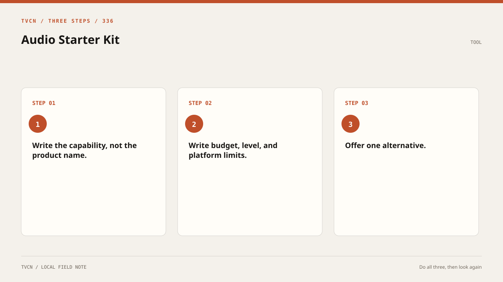

Audio starter: shotgun, lav, recorder, headphones; dialogue first.

<!-- DIAGRAM_START -->
<h2>Diagram</h2>
<figure>
  
  <figcaption>Do the three steps in order, then look again at the image or file.</figcaption>
</figure>
<!-- DIAGRAM_END -->
<h2>On set</h2>

Shotgun, lav, recorder, and headphones. Record thirty seconds of dialogue and check the noise floor.

<h2>Do this</h2>

An entry audio kit: shotgun, lav, recorder, monitoring headphones; dialogue first, ambience later.
<ol><li>Shotgun into the recorder, lav as backup.</li><li>Record thirty seconds of dialogue and listen to the noise floor.</li><li>Wear the headphones; do not trust the meter alone.</li></ol>
<h2>Avoid</h2>

Do not bring only a shotgun; indoor dialogue without a lav backup dies in a draft.

<h2>Check</h2>
<ul><li>Shotgun and lav record simultaneously and each works alone.</li><li>A thirty-second dialogue test reveals the noise floor.</li><li>Someone wears headphones during recording, not just watching meters.</li></ul>
