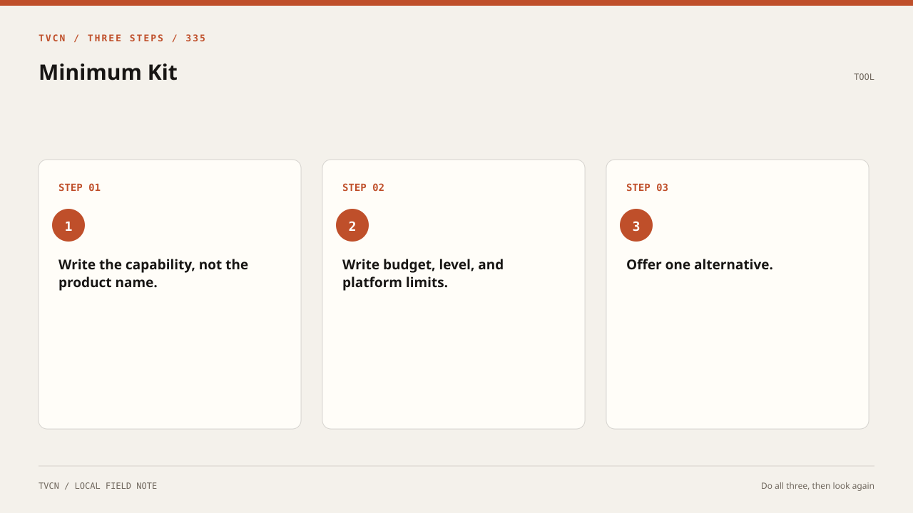

Minimum kit: a camera, one standard zoom, a tripod, and a mic that works.

<!-- DIAGRAM_START -->
<h2>Diagram</h2>
<figure>
  
  <figcaption>Do the three steps in order, then look again at the image or file.</figcaption>
</figure>
<!-- DIAGRAM_END -->
<h2>On set</h2>

A body, standard zoom, tripod, and lav. Keep 20 percent of the budget for storage and batteries.

<h2>Do this</h2>

A minimum kit: a camera that records, one standard zoom, a tripod that holds, and a mic that captures dialogue.
<ol><li>List capabilities first: power on, zoom, hold steady, capture clean dialogue.</li><li>Reserve 20 percent of budget for storage and batteries.</li><li>Write a substitute for each missing item, such as a phone plus lav.</li></ol>
<h2>Avoid</h2>

Do not pick a camera body first; write the four jobs it must do.

<h2>Check</h2>
<ul><li>Each of four items maps to one named capability.</li><li>Storage and batteries take about 20 percent of budget.</li><li>Every missing item has a workable substitute.</li></ul>
