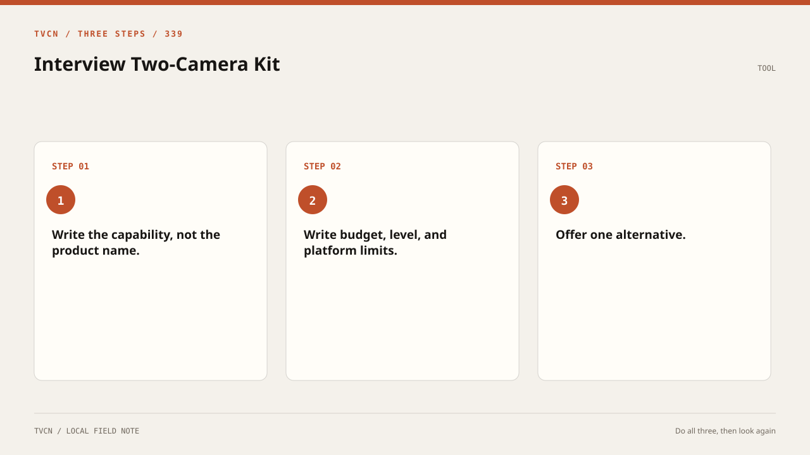

Interview kit: A camera medium, B close, shotgun, backup lav; the edit gets choices.

<!-- DIAGRAM_START -->
<h2>Diagram</h2>
<figure>
  
  <figcaption>Do the three steps in order, then look again at the image or file.</figcaption>
</figure>
<!-- DIAGRAM_END -->
<h2>On set</h2>

A camera for the medium, B for the close, a shotgun, and a backup lav. Test two-camera sync first.

<h2>Do this</h2>

An interview two-camera kit: A mid-shot, B close-up, plus shotgun and backup lav; editing needs choices.
<ol><li>A camera holds the mid-shot and context, B the close-up and face.</li><li>Shotgun to the main recorder, lav as a backup track.</li><li>Run a two-camera test to confirm sync and framing.</li></ol>
<h2>Avoid</h2>

Do not set both cameras to the same framing; the edit has no choices.

<h2>Check</h2>
<ul><li>A is mid-shot, B is close-up, clearly different.</li><li>Shotgun and lav each record a usable track.</li><li>The two-camera test syncs and framings do not duplicate.</li></ul>
