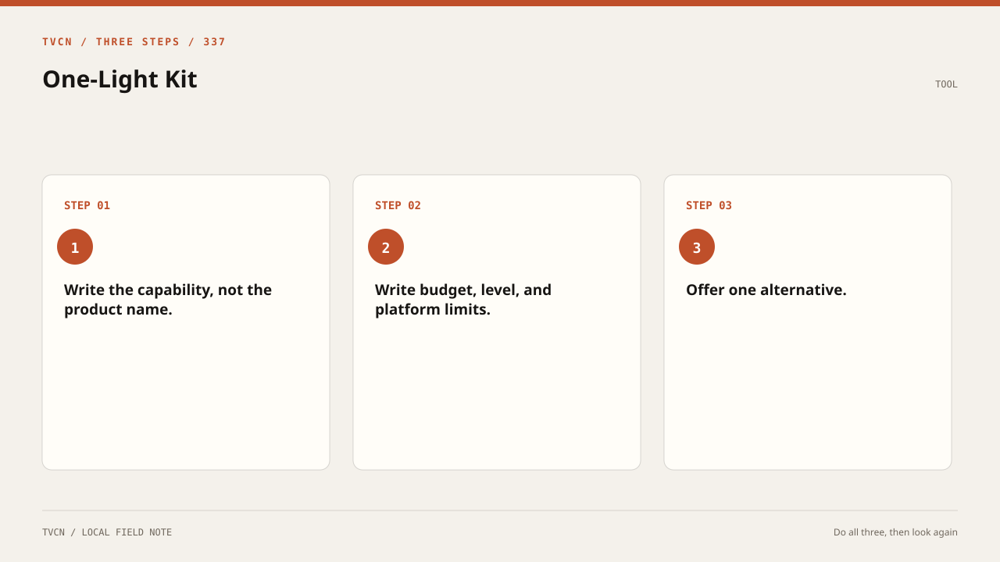

One light: COB, soft box, reflector, two sandbags; one direction first.

<!-- DIAGRAM_START -->
<h2>Diagram</h2>
<figure>
  
  <figcaption>Do the three steps in order, then look again at the image or file.</figcaption>
</figure>
<!-- DIAGRAM_END -->
<h2>On set</h2>

One COB, a 90-centimeter softbox, a reflector, and two sandbags. Shoot half-body before adding a second light.

<h2>Do this</h2>

A one-light kit: one COB, one softbox, one reflector, two sandbags; establish one direction first.
<ol><li>One COB with a 90 cm softbox, shoot a half-body first.</li><li>Use a reflector for shadows before adding a second light.</li><li>Two sandbags secure the stand, even indoors.</li></ol>
<h2>Avoid</h2>

Do not buy a second light first; without one direction, the second only fights it.

<h2>Check</h2>
<ul><li>One light and softbox produce a usable half-body setup.</li><li>Shadows are filled with a reflector before a second light.</li><li>Two sandbags keep the stand stable when nudged.</li></ul>
