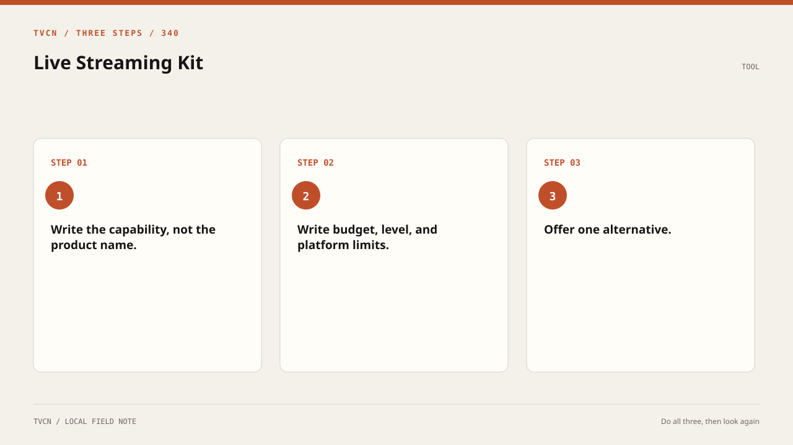

Live kit: camera, capture card, wired network, hotspot backup, local recording; uptime first.

<!-- DIAGRAM_START -->
<h2>Diagram</h2>
<figure>
  
  <figcaption>Do the three steps in order, then look again at the image or file.</figcaption>
</figure>
<!-- DIAGRAM_END -->
<h2>On set</h2>

Camera, capture card, wired network, hotspot backup, and local recording. Rehearse one network drop.

<h2>Do this</h2>

Live streaming kit: camera, capture card, wired network, backup hotspot, local recording; continuity first.
<ol><li>Camera into capture card, wired network for the stream.</li><li>Test the backup hotspot and record locally at the same time.</li><li>Run one disconnect drill and log the switchover seconds.</li></ol>
<h2>Avoid</h2>

Do not rely on venue Wi-Fi alone; one drop erases the stream.

<h2>Check</h2>
<ul><li>The stream runs wired and the backup hotspot is speed-tested.</li><li>A complete local recording exists alongside the stream.</li><li>The disconnect drill logs switchover and recovers within ten seconds.</li></ul>
