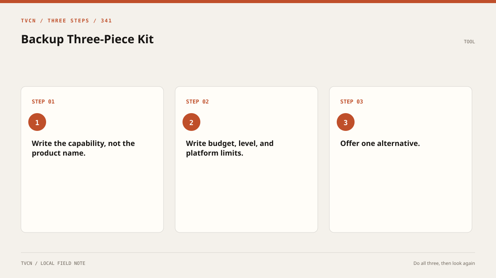

Three copies, two media types, one off-site. RAID is not backup; a sync folder is not backup either. Deletion syncs, and ransomware encrypts the sync target too.

<!-- DIAGRAM_START -->
<h2>Diagram</h2>
<figure>
  
  <figcaption>Watch “Minimum: one working SSD, one on-set drive, one” and “Working: SSD working disk, NAS or two-drive backup,”; judge whether the symptom can be restated as one observable sentence.</figcaption>
</figure>
<!-- DIAGRAM_END -->
<section><h2 id="section-1">3-2-1 is the floor, not a slogan</h2>

<ul><li><strong>Minimum:</strong> one working SSD, one on-set drive, one drive or cloud copy taken away after the shoot.</li><li><strong>Working:</strong> SSD working disk, NAS or two-drive backup, offline drive; add LTO or cold cloud for critical projects.</li><li><strong>Team:</strong> checksums, version naming, restore log, media rotation; anyone can find and open the original footage a month later.</li></ul>
<h2 id="section-2">Three things after a copy</h2>
<ol><li>Name by project/date/camera; do not carry “New Folder” into post.</li><li>Generate checksums or at least compare file count and total size; do not trust a progress bar.</li><li>Pick one random file, open it from the backup media and play ten seconds.</li></ol>
<h2 id="section-3">Restore drill</h2>

Once a month, restore one random project to an empty machine and record the time and failure points. A backup without a restore drill is only reassurance.
</section><section><h2 id="section-4">On set</h2>
Card reader, SSD, and hard drive. Copy, verify, and move offsite the same day. Confirm three copies before formatting.
</section><section><h2 id="section-5">Avoid</h2>
Do not format the card after one copy; at that moment you have no backup.
</section>
<h2>Check</h2><ul><li>SSD and hard drive each hold a copy with matching file counts.</li><li>Verification happens the same day and is logged.</li><li>Three copies exist before formatting, one offsite.</li></ul>

<!-- SOURCES_START -->
## Experience note

Experience note:This page draws on 3 projects with one lead and a two-to-three-person crew, a fixed budget and schedule; it covers the decision order for “Backup Three-Piece Kit”, not an external laboratory test, multi-camera, union crews, stunts or high-risk sets.
<!-- SOURCES_END -->

